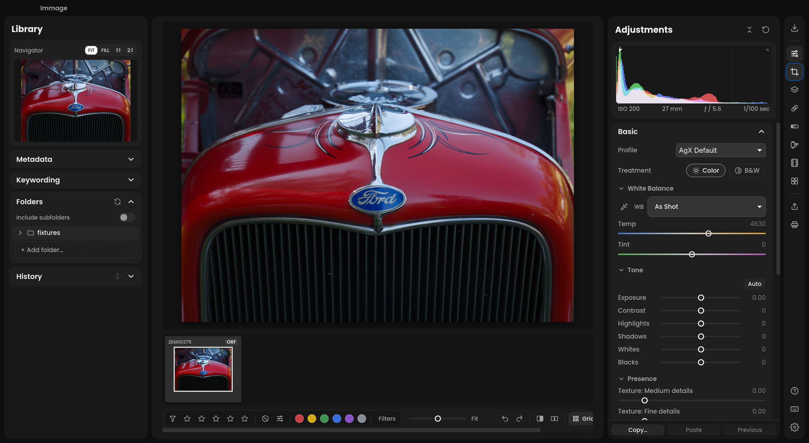

# Immage

Immage is a raw photo editor with familiar panels, sliders and shortcuts,
powered by [darktable](https://www.darktable.org/). It is for photographers
who want a straightforward editing workflow, sensible defaults and photos
organized in folders rather than an editor’s catalog.

A personal, non-commercial project, Immage is available for macOS, Windows
and Linux. **All builds are alpha; bugs are expected.**

[Website](https://immage.photo/) ·
[Download Immage](https://github.com/Rhettus/immage/releases) ·
[Getting started](app/docs/getting-started.md) ·
[User guide](app/docs/README.md) ·
[Release notes](RELEASE_NOTES.md)

## What you can do

- Edit with familiar tone, color, detail and lens correction tools.
- Switch to [Advanced mode](app/docs/advanced-mode.md) to work with darktable's own modules.
  When the mode button has a green dot, hover over it to see which active
  module edits require Advanced mode.
- Calibrate colors from a photographed ColorChecker or SpyderCheckr in Advanced mode.
- Find commands in File, Edit, Photo, View and Help menus that show their keyboard shortcuts.
- Grade colors with live wheel previews and one undo step per drag.
- Jump between edits in [History](app/docs/history-and-sync.md) with custom
  AgX profile settings preserved.
- Make local adjustments with brushes, gradients, range masks and AI selections.
  Hover over range controls to preview the mask on the photo.
  In Advanced mode, apply built-in presets, import darktable `.dtpreset`
  files, save or delete your own module presets, including within masks, and
  change the order a photo's modules run in.
  Copied AI masks are recalculated for each destination photo.
- [Heal, clone, fill and blur with multi-spot editing and area color sampling](app/docs/heal.md), [simulate film stocks and papers](app/docs/film-simulation.md)
  with a one-time data download from GitHub, convert film negatives with input
  and working color profiles, merge HDR photos, and preview panorama projection
  and crop before merging.
- Save [Develop presets](app/docs/presets-and-looks.md) with optional Film Simulation,
  apply film looks, and compare edits. Copy settings across photos, including RAW
  tone mappers and optional automatic white balance for each destination.
- Use Immage in English or French.
- Choose from eight built-in interface themes ordered from darkest to lightest,
  or import a custom color theme.
- Back up your settings, presets, looks, Edit In plugins and keywords to one
  file, and restore the parts you choose from it.
- Add optional Geoapify place-name search to the location map; map tiles and
  manual pin placement work without a search key.
- Browse folders directly, import from a card to a local folder or mounted NAS
  share with the [built-in importer](app/docs/import.md). Card scans match
  against the local library and can also check [Immich](app/docs/immich.md)
  when enabled. Immich also supports search and export.
- Remove all listed folders on a drive at once from its heading in
  [Library](app/docs/library.md#folders). Photos and sidecars stay on the drive.
- Find photos with filters, or describe them with optional Smart search, which
  runs on your computer. The [Find panel](app/docs/library.md#find) in Grid
  filters by capture date and time, GPS availability, image dimensions,
  descriptive metadata, and camera settings. It keeps filters active across
  folder changes and remembers its own width and visibility separately from
  the editing panel. Clearing a saved Find filter removes its checkmark from
  the saved-filter menus. Use the arrow buttons in **Manage saved filters…**
  to reorder saved filters.
- Cull in the grid with **View > Culling Preview**, ratings, color labels and keywords. Click the tag icon or press **K** to keyword the photo in the lightbox. Use **×** beside a recent keyword to remove it from the recent list and hide it from autocomplete.
- Remove a photo keyword from a selection with **×** on its chip in the **Keywording** card.
- Rename photos individually or in bulk from the [Library grid](app/docs/library.md#rename-photos), with a file count, a live filename example, and sidecars kept alongside.
- [Reset edits](app/docs/history-and-sync.md#reset-all) from Adjustments or the Library grid, with a confirmation you can turn off.
- Drag photos or [whole folders](app/docs/library.md#moving-and-copying-folders) onto another folder, including a mounted SMB share, to move or copy them along with their sidecars. Folder copies skip Finder’s `.DS_Store` and Windows Explorer’s `Thumbs.db`. See [macOS SMB troubleshooting](app/docs/library.md#troubleshooting-macos-smb-transfers) to capture transfer errors.
- Browse indexed photos on mapped network shares with experimental
  [Immage Accelerator](app/docs/immage-accelerator.md) support, including camera thumbnails up
  to 400 × 400 pixels for unedited originals, optional NAS Smart Search, and NAS progress in
  Preferences → Immage Accelerator (Experimental).
- [Export](app/docs/export.md) to a folder or an Immich album, with custom
  dimensions, borders and file-name templates.
- Use [Edit In](app/docs/edit-in.md#open-photos-as-layers-in-photocraft) to open
  edited photos as full-size 16-bit ProPhoto RGB layers in PhotoCraft.
  Continue editing the composite of a layered TIFF in Immage.
- On Windows and macOS, [stack a focus bracket in Helicon Focus](app/docs/edit-in.md#stack-a-focus-bracket-in-helicon-focus)
  with your choice of rendering settings, or use Auto DNG to stack RAWs in the background.
  Edit the resulting TIFF or DNG in Immage.
- Print a photo, or a contact sheet of many with their file names, or save a
  PDF, with your printer's ICC profile, and [soft proof](app/docs/print.md) the
  photo on screen first.

Your originals stay untouched. Edits are saved automatically in XMP sidecars
beside your photos. Simple mode offers a selected set of darktable’s tools in a
fixed workflow, and Advanced mode adds darktable’s own modules; photographers
who need every pipeline control can continue editing in a compatible version of
darktable.

**Using darktable already?** Try Immage on copies first. Immage uses a
development version of darktable, and stable releases may not read its newer
module or mask formats. See [darktable compatibility](app/docs/darktable.md).
Immage-specific sidecar conventions are documented in the
[developer XMP inventory](app/docs/dev/xmp-conventions.md).

## Download and install

Choose your platform on the [Releases page](https://github.com/Rhettus/immage/releases):

| Platform | Requirements | Download |
| --- | --- | --- |
| macOS | Apple silicon, macOS 15 or newer | `.dmg` |
| Windows | Windows 10 or 11, x64; Windows on ARM through x64 emulation | `-setup.exe` installer |
| Linux | x86-64 or ARM64, glibc 2.35 or newer (Ubuntu 22.04 and later, including Linux Mint 22.x) | AppImage |

Immage needs at least 8 GB of memory; 16 GB and a GPU with OpenCL are
recommended. See [System requirements](app/docs/getting-started.md#system-requirements).

The Windows installer offers **Just for me** (under
`%LOCALAPPDATA%\Programs\Immage`, without administrator permissions) or
**Everyone on this computer** (under Program Files, requesting permission after
selection). Updates preserve the installation's location and scope.

Builds are not yet signed with a developer certificate; the release page
explains how to open them the first time. Immage checks for updates daily;
you can install them through **Preferences › About › Updates**.

For Linux launch options, see [Linux setup and troubleshooting](app/docs/preferences.md#performance).

## Learn more

- [User guide](app/docs/README.md): getting started, editing tools and settings.
- [darktable compatibility and module reference](app/docs/darktable.md).
- [Troubleshooting and reporting issues](app/docs/troubleshooting.md): diagnostics, the support bundle and the bug report form.
- [Library culling](app/docs/library.md): review photos with keyboard navigation, flag picks with P, a bottom zoom slider, read-ahead, and optional camera previews for edited RAWs.
- [Developer docs](app/docs/dev/README.md): building, architecture and contributing to the code.
- [Credits and licenses](app/docs/credits.md): projects, AI models and map attribution.

## License

Immage is GPL-3.0-or-later. Bundled third-party content keeps its own license.
See [license details and source availability](app/docs/credits.md#license).
