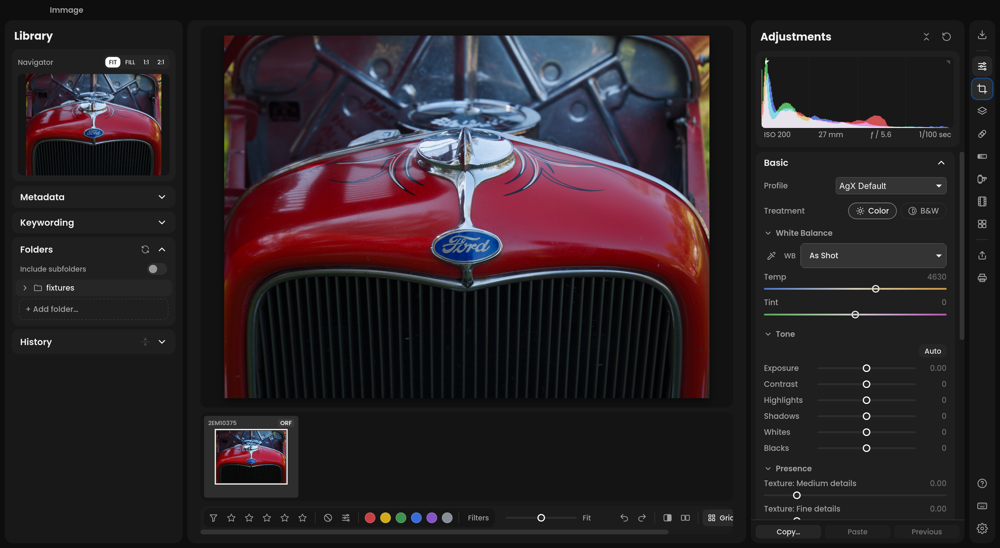

# Immage

Immage is a raw photo editor with familiar panels, sliders and shortcuts,
powered by [darktable](https://www.darktable.org/). It is for photographers
who want a straightforward editing workflow, sensible defaults and photos
organized in folders rather than an editor’s catalog.

A personal, non-commercial project, Immage is available for macOS, Windows
and Linux. **All builds are alpha; bugs are expected.**

[Website](https://immage.photo/) ·
[Download Immage](https://github.com/Rhettus/immage/releases) ·
[Getting started](app/docs/getting-started.md) ·
[User guide](app/docs/README.md) ·
[Release notes](RELEASE_NOTES.md)

## What you can do

- Edit with familiar tone, color, detail and lens correction tools.
- Make local adjustments with brushes, gradients, range masks and AI selections.
- Heal and clone, convert film negatives, and merge HDR photos or panoramas.
- Apply presets and film looks, compare edits, and copy settings across photos.
- Browse folders directly, import from a card with the built-in Immporter,
  and optionally search and export to an [Immich](app/docs/immich.md) library.
- Export to a folder or an Immich album, with borders and file-name templates.

Your originals stay untouched. Edits are saved automatically in XMP sidecars
beside your photos. Immage offers a selected set of darktable’s tools in a
fixed workflow; photographers who need every module and pipeline control
can continue editing in a compatible version of darktable.

**Using darktable already?** Try Immage on copies first. Immage uses a
development version of darktable, and stable releases may not read its newer
module or mask formats. See [darktable compatibility](app/docs/darktable.md).

## Download and install

Choose your platform on the [Releases page](https://github.com/Rhettus/immage/releases):

| Platform | Requirements | Download |
| --- | --- | --- |
| macOS | Apple silicon, macOS 15 or newer | `.dmg` |
| Windows | Windows 10 or 11, x64; Windows on ARM through x64 emulation | `-setup.exe` installer |
| Linux | x86-64 or ARM64, glibc 2.35 or newer (Ubuntu 22.04 and later, including Linux Mint 22.x) | AppImage |

Builds are not yet signed with a developer certificate; the release page
explains how to open them the first time. Immage checks for updates daily;
you can install them through **Preferences › About › Updates**.

For Linux launch options, see [Linux setup and troubleshooting](app/docs/preferences.md#performance).

## Learn more

- [User guide](app/docs/README.md): getting started, editing tools and settings.
- [darktable compatibility and module reference](app/docs/darktable.md).
- [Developer docs](app/docs/dev/README.md): building, architecture and contributing to the code.
- [Credits and licenses](app/docs/credits.md): projects, AI models and map attribution.

## License

Immage is GPL-3.0-or-later. Bundled third-party content keeps its own license.
See [license details and source availability](app/docs/credits.md#license).
