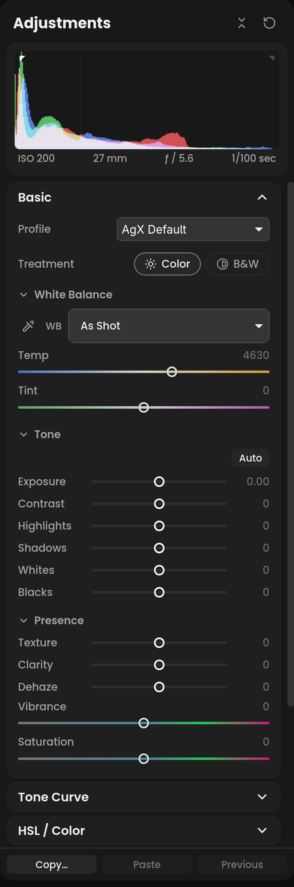
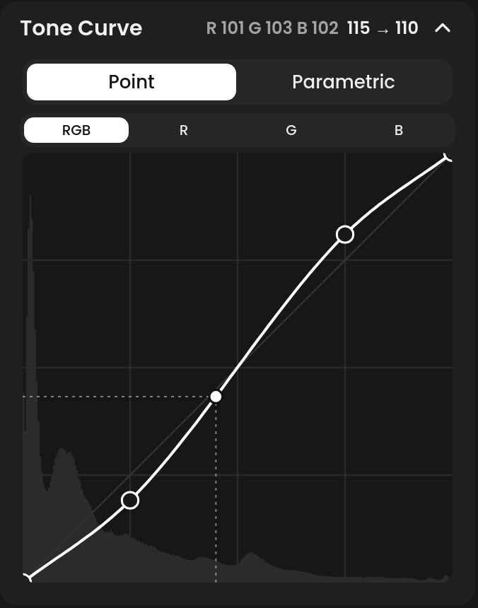
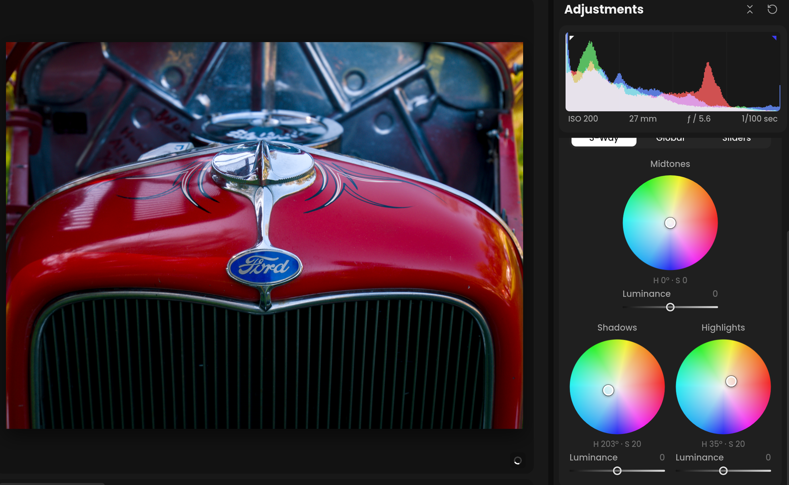

# Adjustments

The **Adjustments** panel holds the familiar develop panels, in their
usual order and with their usual slider names. Each slider drives one of darktable's
modules; hover over a slider's row to see which ("darktable: …").

**If you've used another editor:** the sliders behave as you expect, and
most have the usual range. Where Immage differs, this page says so. There
is no process version to choose: the tone mapper, AgX, plays that part.

## Working with sliders

- **Drag** a slider, or click on its track to jump it there; the photo
  follows either way.
- **Double-click** the slider or its name to reset it.
- **Double-click the number** to type a value; Enter sets it, Esc cancels.
- **Scroll** over a slider to nudge it, if **Scroll adjusts sliders** is
  on in **Preferences › General**. It is off by default, so scrolling just
  scrolls the panel.
- **Hold ⌥ while dragging** some sliders to see what they affect: the
  sharpening and noise sliders show the photo in gray, and
  their masking sliders show where they act.
- While you drag most sliders, the photo renders at half size so it can keep up, and
  sharpens when you let go. Grain, Texture and Sharpening also wait until
  you let go, unless they are what you are dragging. **Preview** in
  Preferences sets how far this goes: Quality turns it off, Performance
  goes further.

**Panels:** click a panel's title to open it. With **Focus mode** on (the
default), opening one closes the others; ⌥-click opens one alongside. The
buttons in the panel's head collapse or expand them all, and **Reset all**
takes the photo back to its starting point (⌘Z undoes it).

**Preset rows:** some sections have a row of swatches or buttons, such as
the B&W filters or the grain amounts. Hover over one to preview it on the
photo, rendered at the size the photo is shown (up to 3200 pixels on the
long edge) so grain previews as sharp as it will be; click to apply it.

## Basic

**Profile**: the color look a raw starts with. The first group is AgX's
own looks, which change how colors brighten toward white and the shape of
the tone curve: **AgX Default**, **Unmodified Primaries**, **Blender**,
**Blender Punchy**, **Sigmoid-like**, **Sigmoid-like Smooth** and
**Smooth**. Contrast, Whites and Saturation work from the look's own
values. The second group is darktable's color balance rgb: **Standard**,
**Natural Skin**, **Vibrant Colors** and **Legacy**, which add
colorfulness on top of AgX Default. New raws get the profile set in
Preferences (AgX Default unless you change it).

Choose **Load preset…** at the bottom of Profile to bring in your own AgX
presets. Open a photo first. The dialog lists user presets from darktable's
standard configuration folder; **From darktable** refreshes that list.
Alternatively, choose **From file…** and open an exported darktable
`.dtpreset` or `.dtstyle` file. Only AgX settings are imported from a style;
other modules and blending settings are excluded. Check the presets you want
and click **Add**. The first added preset is applied to the open photo.

Added presets appear under **My Presets** and remain available after restarting
Immage. Duplicate names get a numbered suffix. Selecting one switches to AgX,
loads its curve, color look and black/white relative exposure, and keeps your
other adjustments. Contrast, Whites, Blacks and Saturation work from the
preset's values. You can also choose an imported profile in Preferences as
the default for new raw photos. If darktable uses a custom configuration
folder, export the preset from darktable and use **From file…**.

**Treatment**: **Color** or **B&W**. Black and white swaps **HSL / Color**
for **B&W Mix**.

**White Balance** (darktable's color calibration)

- **Temp**: 2000-25000 K. **Tint**: -150 to +150. Both start **As Shot**,
  and double-click goes back to it.
- The eyedropper (W) picks a neutral spot: click something that should be
  gray. It refuses a clipped or black spot. Esc cancels.
- The **WB** menu has **As Shot**, **Auto**, **Daylight**, **Cloudy**,
  **Shade**, **Tungsten**, **Fluorescent** and **Flash**.
- **Auto** judges the light by the brightest unclipped parts of the photo.
  When the camera set its own white balance, Auto trusts it and only nudges
  it, so a sunset or a field of green keeps its color.

**Tone**

- **Auto**: sets Exposure, then Contrast, Highlights, Shadows, Whites and
  Blacks from the photo. It brightens a dark photo only until its bright
  parts are well placed, and darkens a bright one only until its shadows
  are, so a night scene stays dark and snow or a sunny beach stays bright.
  Such a scene also keeps its shadows unlifted, or its highlights and
  blacks untouched. A photo with nothing dark in it, such as a plane
  against clear sky, keeps its blacks too, rather than its sky being
  darkened. A flat photo gets only a moderate Contrast boost, since
  Whites and Blacks already widen its tones. Under AgX it also sets AgX's
  range.
- **Exposure**: -5 to +5 stops.
- **Contrast**, **Highlights**, **Shadows**, **Whites**, **Blacks**: -100 to
  +100. Whites moves the top of the tone mapper's curve, and under AgX
  also brightens or darkens the brightest tones ahead of it; Blacks moves
  the black point, and works the same at any Exposure.

**Presence**

- **Texture**: fine detail; negative values smooth it.
- **Clarity**: midtone contrast.
- **Dehaze**: removes haze; negative values add it.
- **Vibrance** and **Saturation**.

Clarity and Texture run on **contrast & texture** by default, where each
shows **Medium details** and **Fine details** (-1 to 5) instead of a single
slider; choose local contrast or diffuse or sharpen in Preferences › Modules
for the slider.
**Advanced** reveals Coarse details (-1 to 5), Base detail level (1–15), Halo
control (-10 to 10), Noise bias (0–1), Shadows and Highlights (-5 to 5).
Clarity and Texture use separate instances, including on masks.

## Contrast equalizer

Choose **Custom**, then **Global › Contrast › contrast equalizer** in Preferences › Modules
for a photo whose Contrast has not been edited. In Basic, a graph replaces
the Contrast slider. It adjusts detail by spatial scale rather than tonal range.

Select **Luminance**, **Chroma**, **Edges**, **Luminance noise** or **Chroma
noise**. Each channel has six points, from **Coarse** on the left to **Fine**
on the right, each drawn whole even at the graph's edge. Click near a point
and drag vertically to change that band.
Pull up to boost, down to reduce; the noise channels set noise thresholds.
Click or Tab to a point and use Up/Down to adjust it, or Home to restore its neutral
value. **Reset** restores all five channels. To use the graph inside masks,
choose **Masks › Contrast › contrast equalizer** in the same preferences tab.
Global and mask choices are independent, so global Contrast can use AgX while
masks use the equalizer. Existing adjustments keep their selected module. A green dot on a tool's module icon means another module of that tool also holds adjustments, such as Contrast edited on AgX and then moved to the contrast equalizer, which hides that slider and leaves the edit behind. Open the menu: a green dot marks every module that has adjustments. Modules that share one slider, such as AgX and color balance rgb for Contrast, take the value with you when you switch, so they leave no dot.

## Saturation curve

Choose **Custom**, then **Global › Saturation › saturation curve** in
Preferences › Modules for a photo whose Saturation has not been edited. In
Basic's Presence, a curve replaces the Saturation slider. It changes colors
by how saturated they already are: across the graph, from **Muted** on the
left to **Saturated** on the right; up from the middle line adds,
down takes away. A curve that falls to the right lifts muted colors more
than vivid ones, much as Vibrance does; one that rises does the opposite.

Select **Saturation** or **Brilliance**. Saturation's curve sets how much
saturation each color gets, from none at the bottom to twice its own at the
top. Brilliance's lightens or darkens colors, by the same measure, while
keeping their saturation. Click to add a point (up to 20), drag to move one,
and double-click a point or drag it off the graph to remove it; the end
points stay. **Reset** flattens both curves. To use the curve inside masks,
choose **Masks › Saturation › saturation curve**. Uses darktable's
saturation curve module.

## Tone Curve

Two modes, switched at the top of the panel:

- **Point**: click the curve to add a point (up to 20), drag to move it,
  and double-click it or drag it off the graph to remove it. **RGB** is the
  main curve; **R**, **G** and **B** adjust one channel.
- **Parametric**: **Whites**, **Highlights**, **Midtones**, **Shadows**
  and **Blacks** sliders, named as in Basic, each bending the curve in its
  own band of tones. Three **Split Points** move the borders between the
  bands; Midtones spans the two around the middle split.

The graph shows the histogram behind the curve. Hover over the photo to
see where a pixel sits on the curve. A curve drawn in darktable shows a
note; moving a slider replaces it.

<!-- screenshot: Tone Curve in Point mode, RGB, an S curve, pointer over the photo showing the probe chip -->

## HSL / Color

**Hue**, **Saturation** and **Luminance** tabs, each with eight bands:
**Red**, **Orange**, **Yellow**, **Green**, **Aqua**, **Blue**, **Purple**
and **Magenta**. Hue moves each band up to 30° either way. Saturation at
-100 turns its color gray. Luminance changes vivid colors the most and
leaves pale ones nearly as they were.

Each band acts most on its own color and fades out toward the bands
either side. Blue and Purple sit close together, so each
also reaches part of the other's colors.

A photo whose HSL was set in darktable, or in Immage before 0.37.0, can
open with a band's setting spread over its neighbors' sliders, or past
the end of a slider. It looks as it did; moving a slider carries on from
there.

Hover over the photo: the panel's title shows the color under the pointer,
and its band's sliders glow. Uses darktable's color equalizer.

## B&W Mix

Shown instead of HSL / Color when **Treatment** is **B&W**. The same eight
bands set how light each color turns in gray.

- **Auto** mixes from the photo's own colors, so colors that would merge
  into one gray stay apart.
- The filter swatches, **None**, **Red**, **Orange**, **Yellow**, **Green**
  and **Blue**, work like a colored filter on black and white film. Hover
  to preview.

For working on black and white tones as zones, see [Zone
System](zone-system.md).

## Color Grading

**Shadows**, **Midtones**, **Highlights** and **Global**, each with a
**Hue** (0-359°), **Saturation** (0-100) and **Luminance**. Switch the view
between **3-Way**, **Global** and **Sliders**.

On a wheel, the angle is the hue and the distance from the middle is the
saturation. Drag the dot; double-click a wheel to take its saturation back
to 0.

<!-- screenshot: Color Grading, 3-Way view, warm highlights and cool shadows set -->

## Detail

Enable **Detail loupe** in Preferences › General › Workspace for compact
100% previews above Detail and Presence (a mask's Presence group shows
one too). Their point pickers select the same
area. Detail and grain drags preview that area directly; with the loupe off,
they keep the visible image at full preview resolution. Release updates the
full visible view. Tone and contrast controls retain whole-image previews.

**Sharpening** (darktable's sharpen, or diffuse or sharpen)

Sharpen as your last step. New raws start with it off. It runs on
darktable's sharpen unless [Preferences › Modules](preferences.md#modules)
picks diffuse or sharpen, and each shows its own sliders:

- sharpen:
  - **Amount**: 0-100; 0 is off.
  - **Radius**: 0.5-3 px (2 by default).
  - **Threshold**: 0-100 (5 by default). Leaves differences smaller than
    this alone, such as noise.
- diffuse or sharpen, which is slow to render: while it is on, Exposure,
  Blacks, Temp, Tint and the lens corrections take longer to update the
  photo.
  - **Amount**: 0-5; 0 is off.
  - **Radius**: 1-12 px (3 by default).
  - **Sensitivity**: 0-4.
- **Masking**, on either: 0-100. Sharpens only the edges as it rises;
  ⌥-drag shows where. Raws only.

**AI Denoise** (darktable's raw denoise)

Click **Denoise…**, pick an **Amount** (1-100) and click **Denoise**.
The dialog previews a piece of the photo at 1:1, starting where you are
zoomed in. Amount changes it at once. Hold the preview to see it without
AI Denoise, and drag on the small photo beside it to preview another
part, which takes a moment.
Immage writes a new DNG beside the raw, named `<name>_raw-denoise.dng`.
This takes up to a minute, and the model downloads on first use. It runs
in the background: you go on editing, this photo or another, while the
bottom left of the photo shows it under way. When it's done, **Open**
there opens the DNG. The DNG starts with the raw's edit as it was when
you clicked Denoise, and the first time it opens, Profiled Denoise's
Luminance and Color go to 0, since the AI took the noise out. It is a
photo of its own and sits after the raw in the folder; the raw itself
isn't changed. Raws only, in a folder on this computer, one at a time.
To try another Amount, run it again on the raw; the next DNG is
`<name>_raw-denoise_1.dng`.

The DNG retains its format identification, color calibration and sensor layout
when the source EXIF and denoise marker are added, so it also opens in darktable.
Run AI Denoise again to replace an older result that cannot open.

**Profiled Denoise** (darktable's profiled denoise)

- **Luminance**, **Color** and **Detail**, 0-100. Detail keeps edges and
  texture out of the noise reduction (raws only). New raws start with
  it off, as darktable's AgX workflow adds it only where a photo needs it.

Raw-only sliders are grayed out on a JPEG.

## Lens Corrections

**Defringe** removes color fringes using darktable's chromatic aberrations:
**Amount** sets strength and **Radius** sets its reach. Amount 0 switches it
off. This is separate from Remove Chromatic Aberration. A mask's Defringe
uses the same module.

- **Enable Profile Corrections**: corrects distortion and vignetting for
  the lens darktable detects (through the lensfun database). Immage bundles
  a current snapshot of that database, so recent cameras, including fixed-lens
  compacts like the Sony ZV-1, have profiles. The Windows and macOS builds always use it; on Linux, as in darktable,
  a lensfun database installed on the system is used instead (update it with
  `lensfun-update-data`). A camera or lens still missing from the database
  gets no correction.
- **Lens**: **Auto** uses the lens matched from the photo's EXIF, shown
  beside it. Open the drop-down to pick another from the lensfun lenses that
  fit the camera (all of them when the camera is not in the database). Type in
  the search box at its top to filter; every word you type must appear in
  the lens's maker or name, in any order, so `12-32` finds the Panasonic
  12-32mm and `pana 12-32` narrows it to Panasonic. Up and Down move, Enter
  chooses and Esc closes. Choosing a lens uses its lensfun profile, even on a
  raw whose own embedded correction Auto would use. The choice follows the photo's edits: undo, copy
  and paste, presets and Reset include it. It needs Enable Profile
  Corrections to be on.
- **Remove Chromatic Aberration**: on by default.

The **Default** preset that new raws get turns profile corrections on.

**Hot Pixels** (raws only) replaces pixels much brighter than their
neighbors, the stuck or hot pixels of long exposures and high ISO, with
the brightest of those neighbors. It is off until **Remove Hot Pixels**
is turned on.

- **Strength**: how much brighter than its neighbors a pixel must be to
  count as hot. At 25 it must be 8 times brighter, at 100 twice as
  bright; higher finds more.
- **Threshold**: how bright a pixel must be to be checked at all; lower
  finds hot pixels in darker areas.

## Transform

**Upright** corrects the photo from its own straight lines, using
darktable's line detection and fit from its rotate and perspective module:

- **Auto**: levels the photo and makes vertical lines plumb. It corrects
  horizontal lines too when the photo has enough of them.
- **Level**: rotation only. The crop tool's **Auto** uses the same fit
  but sets Rotate instead.
- **Vertical**: level, with vertical lines made plumb.
- **Full**: level, with vertical and horizontal lines both corrected.
- **Guided**: drag along two to four lines that should be plumb or level.
  The photo is corrected after each guide. Drag a guide's end to move it,
  or select a guide and press Delete to remove it. Press **Done** or
  Escape to finish.
- **Off**: removes the Upright correction.

Auto, Level, Vertical and Full set the Manual sliders back to 0.
These modes also work on cropped photos and portraits, including photos turned
upright by the camera's orientation metadata. Detection uses the available
photo region; a photo without enough straight lines may still need Guided.

**Manual** adjusts on top of Upright:

- **Vertical** and **Horizontal**: correct converging lines.
- **Rotate**: -45° to +45°.
- **Aspect**: stretches the photo wider or taller, 0.5× to 2×.

A grid shows over the photo while a Transform slider moves or Guided is
on. The edges the correction pulls in are cropped automatically.

**Straighten**, the panel's first section: press its button, then drag
along a line that should be level or upright, and Rotate is set to match.
Holding ⇧ and dragging on the photo does the same without the button.
The crop tool has it too; see [Crop](crop.md).

## Effects

**Post-Crop Vignetting**: **Amount**, **Midpoint**, **Roundness** and
**Feather**. While Effects is open and Amount isn't 0, guides on the photo
show the vignette. Drag the midpoint to move it, an edge to change the
feather, or the center to move the whole vignette.

**Grain**: **Amount** and **Size**, with **None**, **Low**, **Medium** and
**Heavy** swatches that show a sample of the grain.

## Tone mapper

How the scene's light is fitted to the screen isn't a slider in this
panel. Immage gives a photo opened for the first time darktable's **AgX**,
which keeps bright colors from going garish. A photo started under
darktable's Sigmoid, in darktable or an earlier Immage, keeps it.

See [Preferences](preferences.md).

Loupe rendering pauses while selecting or browsing photos in grid view and
refreshes when you return to the photo view.
