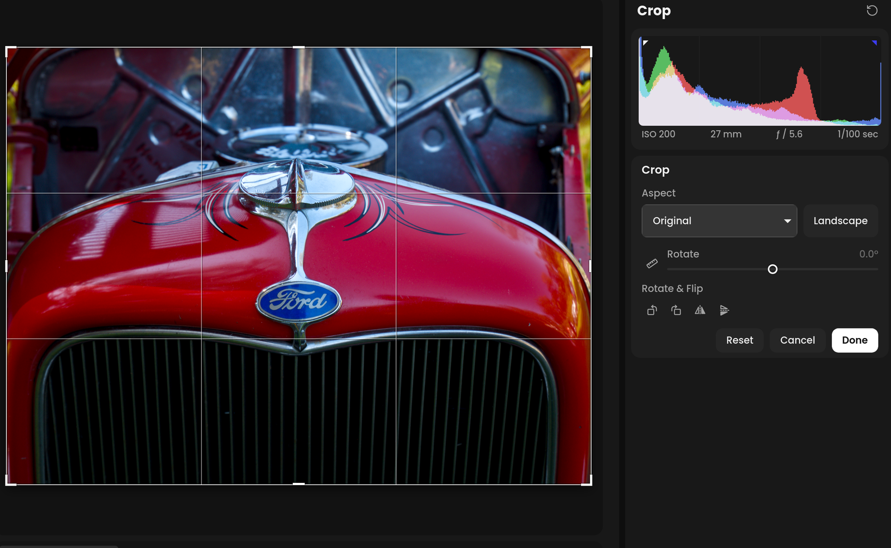

# Crop

Crop, straighten, rotate and flip the photo.

**If you've used another editor:** it works like the usual crop tool, with
the usual keys: R opens it, X swaps landscape and portrait, and holding ⇧ draws a
straighten line.

Open it with **Crop** on the rail, or R. While cropping, the whole photo
shows, with the crop on top.

<!-- screenshot: Crop tool on a landscape photo, guides showing, the Crop panel with Done -->

## Cropping

Drag a corner or edge to resize the crop, or drag inside it to move it.

**Aspect**: **Free**, **Original**, **1 × 1**, **4 × 5 / 8 × 10**,
**5 × 7**, **2 × 3 / 4 × 6**, **3 × 4**, **16 × 9**, **16 × 10**, **1 × 2**
and **1 × 3**. Below them are your recent custom aspects, and the photo's
own if it is unusual. **Enter Custom…** takes any width and height,
decimals included, such as 1 × 2.35.

**Orientation**: the landscape / portrait button, or X, turns the aspect.
Dragging a corner across the diagonal turns it too. Opening Crop preserves the
photo's current orientation; dragging an edge keeps the selected orientation
and aspect ratio.

## Straightening

- Click the straighten button (the ruler), then drag along something that
  should be level or upright.
- Or hold ⇧ and drag anywhere on the photo.
- Or use the **Rotate** slider, which is the same as Transform's.

## Rotating and flipping

| Button | Key |
| --- | --- |
| Rotate left | ⌘[ |
| Rotate right | ⌘] |
| Flip horizontal | |
| Flip vertical | |

The crop turns with the photo.

## Leaving the crop tool

- **Done**, R or Enter applies the crop.
- **Cancel** or Esc leaves without applying it.
- **Reset** takes the crop and angle back to the whole photo.

A photo that has never been cropped starts with the **Original** aspect.
