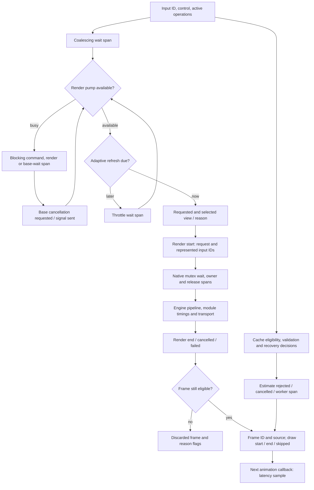

# GUI performance tracing

The existing [slider sequence](diagrams/slider-sequence.svg) describes the
three-process rendering flow. This diagram shows the diagnostic points:



## Collection

Run the existing GUI benchmark in Preferences → Performance → Measuring. Report
schema 9 includes diagnostics by default, independently of the overlay. For an
overhead comparison, set `localStorage.setItem("immage.perfDiagnostics", "0")` in
the webview developer console before a run; set it to `"1"` to restore diagnostics.
This leaves legacy timing, resource and frontend-work metrics enabled. Alternate
multiple on/off runs with fixed photo, edits, viewport, display and preferences.
Unit tests do not establish profiler overhead on a user's hardware.

## Report fields

- `build`: compile-time Git commit and tracked-dirty state, or null when metadata
  is unavailable. A dirty commit does not uniquely identify source contents.
- `diagnostics.events`: frontend `performance.now()` timestamps and monotonic IDs.
  At most 30,000 events are kept. `droppedEvents` and `unfinished` expose gaps.
- `diagnostics.native`: up to 30,000 engine-mutex spans on an independent native
  clock, with wait, acquisition and release markers, operation names, render
  request IDs, dropped counts and unfinished operations. The release marker
  precedes guard destruction; tracing/unlock overhead can remain unattributed.
- Sample `diagnostic`: frame ID, request ID where applicable, first/latest
  represented input IDs, first-input timestamp, source and dispatch-phase label.
  Sources are `native`, `engine-reuse`, `local-reuse` and `estimated`.
- `latestInputLatency` / `oldestInputLatency`: callback time minus represented
  input timestamps. New input during rendering is not represented in that frame.
  Legacy `total` retains its existing start: the native batch's oldest input or
  an estimate's latest input. Legacy labels and tuner metrics remain unchanged.
- `moduleTimings.status`: pending, complete or unavailable. During diagnostics,
  timings are retrieved by request ID so a later render cannot replace the
  frame's module costs. The bounded pending-module store reports evictions as
  `droppedModuleTimings`.

`command` spans identify auxiliary calls. Commands awaited by the pump carry
`blockingPump`; concurrent saves do not. Coalescing and base waiting have separate elapsed spans. Render events record geometry and
input attribution. `preview.decision` / `preview.selected` explain size changes.
Historical reports may include adaptive-cache validation and estimate events;
the removed experiment no longer emits them.
Shared-transport events identify retries and failures. Hooks do no console logging.

`preview.decision` reports `detail-loupe` when a native detail or grain drag
starts directly in the loupe. Compare first frames and queue delays separately from sustained
frames when checking this policy; full-view probe frames no longer precede the
loupe. The native cache patch retains the scaled GPU checkpoint rather than
the full-resolution input to scaling. Check both `demosaic` and
`demosaicscale` costs on subsequent downstream edits at the same geometry;
size changes can still require upstream processing. Pipe debug logs identify
the retained checkpoint with `scaled_input`. Compare process memory as well
as latency. The headless cache protects its three most recently retained scaled
checkpoints from ordinary buffer replacement. New geometries replace the oldest
protection; upstream invalidation, memory trimming and cleanup still apply.
Full-resolution demosaiced GPU buffers are not retained by this policy.

For repeated raw processing, launch the engine with separate `-d perf -d pipe`
arguments (the verification harness enables these with `pipeTrace`). Headless
`checkpoint lookup` lines for `demosaic` and `demosaicscale` include pipe identity, run number,
ROI, full lookup `hash`, ROI-independent parameter `state`, bytes, hit status,
and mask/detail/Scharr state. A changed full hash with unchanged parameter state
requires checking ROI and the other reported fields; it does not establish an
upstream edit. `cache replace`, `cache invalidate`, `cache clear`, and
`cache evict` lines record the affected hashes so a missing buffer can be traced
to replacement, explicit invalidation, or memory trimming. Schema 9 GUI
benchmarks collect these same records automatically under
`diagnostics.cache`, without a separate log or verbose pipe tracing. Capture is
enabled only during diagnostic measurements (including tuner measurements).
The request thread uses a thread-local flag; background workers are excluded.
Render records carry the frontend `requestId`; other commands carry a null ID,
a command name and an engine request sequence. Pipe pointer and hashes remain
strings. `fields` contains key/value tokens; `line` preserves the module and
ROI text, including scale. `engineAt` uses an independent engine clock; link by
request ID rather than aligning it with frontend/native timestamps.
At most 10,000 records are retained; `droppedRecords` reports truncation.
`tracedRequests` counts requests with capture markers (zero means no capture).
Each recording resets the store, and export drains pending stderr first;
`stderrDrained: false` means the final records may be incomplete.
Cache contents predating measurement are unknown, so absence of a replacement
record does not prove the buffer was never cached. The analyzer preserves
the complete cache section and attaches matching records to each frame.

`demosaicscale.modify_roi_in()` requests the whole input at scale 1 even when
its output is a smaller preview. Preview geometry changes therefore do not by
themselves prove that demosaic geometry changed. A GPU checkpoint must preserve
its buffer against subsequent in-place colorspace conversion and blending,
respect device ownership and memory limits, and invalidate with upstream
state. Existing per-module GPU inputs are released after processing; a cache
importance hint alone cannot retain GPU storage across requests.

A CPU probe on `nikon.NEF` with successive exposure edits and requested draft
sizes 1000x750, 1000x750, 700x525, 1000x750 confirmed that the smaller render
missed the scaled checkpoint but hit the same demosaic hash and full-resolution
ROI (4286x2844). Only scaling reran; returning to the larger size hit the old
scaled checkpoint. This establishes that geometry changes can reuse the
demosaiced CPU buffer. It does not explain individual macOS GPU misses; those
need the native logs above from the affected machine.

Cancellation request and signal-sent events are separate. Signal-sent means the
cancel command was written, not that rendering stopped. Render cancelled/end
outcomes and native release spans show completion; stale completed base frames
are explicitly discarded.

## Analysis and timeline export

```bash
python3 -I benchmarking/diagnose.py /path/to/gui-report.json \
  --json /tmp/gui-analysis.json --trace /tmp/gui-trace.json
```

Older reports remain readable. The analyzer separates first frame, sustained drag
and release by phase, source and actual dimensions; P95 uses nearest rank. Grouped
frame intervals may skip intervening frames of another source or size, so they
are not the tuner's whole-phase FPS measurement.

Slow frames include stages, largest module costs, frontend queue blockers and
native lock owners. Blocker intervals can overlap: covered time uses their union,
and uncovered time remains unattributed. Dropped/unfinished spans reduce coverage.
The analysis also includes cancellation completion delays and frame/estimate
outcome counts.

`--trace` writes separate Chrome trace-event files for Perfetto or Chrome's trace
viewer: the frontend file and a sibling `gui-trace.native.json`. Their clocks are
not aligned; request IDs connect them. Frontend lanes show elapsed asynchronous
operations, not CPU-execution tracks.

## Measurement boundaries

### Wayland fractional-scale investigation

Compare the same build, copied photo, edits and logical viewer dimensions at
100% and one fractional output scale (125% or 150%). Record the compositor
scale separately from `viewport.dpr`: GTK3 can report DPR 2 at both fractional
scales. Keep preview mode, Balanced preview size, transport, memory limits,
renderer and all other settings fixed. Do not change compositor settings from
the app-only GUI runner; prepare each display configuration separately.

Use this sequence, with fresh approval for each automated GUI run where local
instructions require it:

1. At 100%, run startup/Exposure to establish the production binary, isolated
   fixture and driver work. Retain app geometry, image dimensions and evidence.
2. Collect a GUI benchmark through Preferences with the same fixture and window
   size. Keep the app visible and reject a run with changed viewport or scale.
3. At fractional scale, repeat with **Drag drafts at the screen's scale** on,
   then off. This isolates the existing draft optimization from integer-sized
   settled rendering. The option is available only when the detected screen
   scale is smaller than the webview DPR.
4. Repeat measurements in alternating order to distinguish cache warmup and
   run-to-run variation. Record cold startup separately from warmed edits.

The app-only runner's `gui-benchmark`, `gui-benchmark-screen` and
`gui-benchmark-whole` cases collect one report per launch through the real
Preferences button using Tab/Enter. Fractional cases select the existing draft checkbox with Space;
integer-scale runs use `gui-benchmark`. Each fresh profile starts from defaults.
Use `--viewport WIDTHxHEIGHT` to enforce the comparison's logical inner window
size after startup and before benchmarking. External authorized setup must size
only the dedicated app; the runner observes geometry without compositor calls.
Waiting until the first photo and tour complete avoids resizing during startup.
Preparation failures retain app DOM/geometry and a screenshot when the bound
main URL/handle still match, even if the viewer element disappears.
`run.mjs` copies reports from the run's fixed profile directory, never an
arbitrary status-text path, to the case's `benchmark.json`. The validator rejects
missing phases, invalid dimensions/timings, backgrounding, changed endpoint
viewport/DPR and mismatched draft configuration. It checks endpoint geometry,
not continuous resize history. See the [runner guide](../../../verify/gui/README.md#scaling-benchmark-collection)
and `node verify/gui/benchmark.test.mjs`. The generic keyboard case has a
Linux ARM64 VM passes at DPR 1 and 2; the screen-scale variant also passed at
125%/DPR 2, with screen-scale drafts both enabled and disabled.
Keep output mode, refresh rate and floating/tiled window mode fixed within an
A/B pair; matching logical viewport alone does not control those variables.
The benchmark itself scripts edits inside the app; collecting it
through WebDriver does not turn its samples into pointer-input measurements.

Analyze reports with `benchmarking/diagnose.py`. Compare first-frame, sustained
drag and release separately, grouped by actual frame dimensions and source.
Use native render/module costs to identify engine work; inspect transport,
draw, animation-callback delay, frontend work and resource samples separately.
The next animation callback does not measure compositor presentation. Similar
engine costs with slower callbacks suggest a different investigation, not proof
of a compositor bottleneck. Keep the performance tuner out of these comparisons
because it changes the configuration being measured.

At 125%, DPR 2 has `(2 / 1.25)^2 = 2.56` times the screen's pixel area;
at 150% the ratio is about 1.78. These are pixel-count ratios, not predicted
speedups. `pixelRatio.ts` currently reduces drag drafts only. Settled previews,
zoom geometry and GTK/WebKit surfaces still follow integer DPR. Its existing
comment records jagged settled frames when WebKit enlarged a smaller image
before compositor downsampling; treat sharpness as an acceptance requirement.

The initial 125% VM pair verified smaller ordinary draft dimensions when the
setting is enabled; detail controls can still use full preview resolution.
Native pipeline costs fell for ordinary drafts, while a large invoke/transport
residual remained in both configurations. That residual includes unmeasured
native work, shared-memory preparation/readout and scheduling/delivery; it is
not a measurement of copy time alone or proof of a compositor bottleneck.
Reports used shared transport with no fallback retries. Investigate this
boundary before accepting a settled-resolution change on performance grounds.
One run per setting, different adaptive geometries, queue histories and memory
pressure limit the conclusions. Inspect first/sustained/release groups rather
than comparing only the whole-run duration or mixed-size medians.

Only prototype smaller settled previews after establishing the baseline. Check
fit view, 100% zoom, fine detail, masks/crop overlays, alignment, resize and
moving between outputs before accepting a change. Engine sizing cannot remove
GTK3's integer surface allocation. A software-rendered VM can establish its own
scaling costs, but cannot establish NVIDIA or packaged-WebKit performance.
Treat timings in a VM as approximate comparisons on that VM. Repeat runs and
retain host-load variability; do not extrapolate absolute throughput to native
hardware or attribute every delay to display scale.

The native trace covers every acquisition of the app's main engine mutex,
including auxiliary commands. Tagged thumbnails, imports, exports and AI jobs use
separate engine threads outside that mutex. Their hardware contention cannot be
proven from mutex ownership alone.

The legacy `paint` field measures the next animation callback, not actual screen
presentation or input-to-photon latency. Those need platform profiling or external
measurement. CPU/GPU saturation and memory-bandwidth contention also need platform
profiling; recorded waiting and module wall times establish where to investigate.

### Native transport diagnostic build

`transport.reply` events join to a render by `data.requestId`. They record the
frontend invoke duration, returned byte count and native header durations:
`lockMs`, `requestMs`, `pipelineMs`, `engineWriteMs`, `rustReadMs`, `probeMs`,
`setMs` and `sharedWriteMs`. Pipeline/write are nested inside request; do not
add them to request again. The reserved float32 at header byte 60 carries the
successful Linux shared-file write duration in the reply only. It is zero for
other paths. The shared file keeps its earlier header; read this timing from
the reply event, not the reconstructed frame. Header size remains 64 bytes.
`transport.shared-read` measures the synchronous Linux web-extension call,
including file read, extraction and deletion, with bytes and shared ID. It is
separate from invoke duration. Retry replies produce separate reply events.
Existing draw spans include canvas upload/draw; these events do not isolate
GPU execution or compositor presentation. Native render spans additionally carry
`outputMs` with `allocate`, `convert`, `file` and `free` durations, joined by
`requestId`. Conversion includes OpenMP scheduling and first-touch page faults;
allocation measures only the allocation call. File time includes open, buffered
write and close, without an explicit durability sync. These four stages nest
inside `engineWriteMs`; do not add them again. Reused frames have no output
breakdown (`outputMs: null`). No settled or draft dimensions change.

### Engine intermediate frame storage

`frame_output.rs` owns transient output separately from persistent runtime data.
Linux uses a unique mode-0700 `/dev/shm` directory, falling back to runtime files
only if startup directory creation fails. Windows uses pagefile-backed named
mappings; macOS uses mode-0600 POSIX shared-memory objects. Object names contain
96 bits derived from a random per-instance UUID and the output name; Darwin
names fit its length limit. The app creates/owns/unlinks POSIX names. Capacity
failures surface as request errors, without silently retrying on disk. All three
mechanisms can page out under memory pressure.

Both fresh render frames and previews use this storage. Resolution, BGRA-to-RGBA
conversion and the later Rust-to-WebView transport remain unchanged; the shared
frames preference controls only that later transport. JSON replies publish write
completion. Keep the engine mutex through the complete read, including previews.
`transient_output.h` writes an eight-byte little-endian payload length before
Windows/macOS mapping data; regular file output stays headerless. Rust checks
mapping lengths before copying directly into the response buffer.

On Windows the engine retains the mapping and a manual-reset consumption event.
Rust signals that event after closing its view/handle, including read errors.
The next output write reaps acknowledged handles; live names cannot be overwritten.
This avoids waiting inside the engine for the consumer and allows concurrent
thumbnail workers. Process exit closes remaining Windows handles. The AppState
owner is dropped after Engine and is reference-counted for background work.
POSIX objects/private directories are removed at normal owner drop; abrupt
termination may leave POSIX names or Linux files until reboot/manual cleanup.
Persistent configuration and caches stay in the runtime/cache directories.

Non-GUI storage tests cover permissions, instance isolation, byte roundtrips,
growing/shrinking and malformed mappings, ownership and cleanup. The standalone
`verify/transient-output.c` checks the C POSIX writer and regular-file fallback:

```sh
cc verify/transient-output.c -o /tmp/immage-transient-test $(pkg-config --cflags --libs glib-2.0)
/tmp/immage-transient-test
cargo test --manifest-path app/src-tauri/Cargo.toml --offline --bin immage --no-default-features frame_output::tests
```

Windows/macOS native validation remains necessary. For file-transport changes,
use one native 125% run by default; add 100% for scaling changes or unresolved
findings. Compare `outputMs.file` and total latency without adding nested timings.
The legacy metric name now measures output transport, including mapping setup
and copy. No speedup is assumed from VM runs.

### Overlay intermediate storage

`range_map`, `zones` and `mask_map` share `range.bin` within `FrameOutput`.
All three writers use `transient_write`; regular-file fallback writes in place
without atomic rename or fsync. Their existing engine locks remain held until
Rust has read the bytes. Response dimensions, masks and statistics are unchanged.
The C writer test exercises exact byte transfer, truncation and failure handling.

### Thumbnail intermediate storage

Each tagged `thumb` request uses `FrameOutput::path("thumb-{tag}.rgba")`, preserving
concurrent worker isolation. The blocking task retains an `Arc<FrameOutput>`
until its request/read and removal finish, including error paths and detached
task completion. The engine uses `transient_write`; Rust still sets alpha to 255.
Persistent JPEG encoding and cache writes stay after the reply. Owner lifetime
and byte preservation are covered by the storage tests.

### Denoise intermediate storage

`ai_denoise_preview` uses the owned `denoise-preview.f32` destination. The engine
passes the before/after float RGB arrays as two spans to `transient_write`,
without assembling another combined buffer. Rust appends the payload directly
behind the unchanged dimensions/crop metadata header while holding the engine
lock. The C test verifies two-span concatenation and resize handling; no float
conversion, denoise strength, crop geometry or saved DNG behavior changes.

### Export dialog preview storage

`export_preview` supplies `transient: true` to the ordinary export renderer and
uses an owned `export-preview.jpg` destination. Rust keeps the engine lock until
it has read and removed the output, including request/read failures. On Windows
and macOS that destination is a mapping; Linux uses its private tmpfs directory.
The transient mode is restricted to sRGB JPEG quality 85 without AI upscaling or
negative conversion. `preview_jpeg.h` replaces only the format's write callback:
the export pipe still applies the edits, draft downscaling and frame sizing.
libjpeg encodes to memory with the JPEG plugin's quality-85 optimizer, chroma
subsampling and density settings. Preview-only EXIF/XMP/ICC container metadata
is omitted; the pixels are already sRGB. Actual export format callbacks and
metadata filtering remain unchanged. This avoids EXIF reads, XMP attachment and
post-encode metadata stripping for a container that is displayed then discarded.

Run `python3 verify/check-transient-output.py` after configuring the Linux engine
build. It syntax-checks the engine and runs byte-transfer and JPEG callback tests
without starting the application. JPEG checks decode all five subsampling modes,
verify dimensions/density/pixel error, and exercise output failure and invalid
sizes. Native export-dialog appearance and latency still need validation.

### Cache access bookkeeping

`cache.rs::touch` skips the write-open and `set_modified` when the existing
mtime is less than 60 seconds old. Stale or future timestamps are refreshed;
missing/failed metadata retains the previous best-effort update behavior.
Original directories create their `.used` marker once, then use the same throttle.
There is no growing in-memory path table or background flush queue. Eviction
still sorts persistent mtimes and protects edited originals, with recency rounded
to roughly one minute. Cache contents, budgets and intentional writes are unchanged.

`cargo test --manifest-path app/src-tauri/Cargo.toml --offline --bin immage --no-default-features cache::tests`
covers repeated-hit/marker timestamp stability, stale refresh, eviction ordering,
known thumbnails, cache path validation and edited-original retention. The policy
reduces timestamp writes; metadata reads still occur and native browsing impact
has not yet been measured.

### Reusable engine render buffers

`rgba_output.h` keeps two output mappings for the serialized `_write_rgba`
render/preview callers. It reuses each mapping up to its largest successful
frame size; growth closes the old mapping before replacement. The total retained
capacity is bounded by those two frame high-water marks, not by render count.
BGRA-to-RGBA conversion writes directly into the mapped payload. There is no
per-frame intermediate RGBA allocation, `fwrite` or copy into the mapping.
Regular-file Windows CLI output retains the existing allocation/write path.

POSIX output descriptors and mappings stay open. Linux files stay headerless;
`ftruncate` updates their visible length when payload size changes. macOS objects
retain capacity and publish the current payload length in their eight-byte header.
Darwin permits only one sizing operation per object: growing an allocated object
unlinks and recreates its private name with mode 0600 before mapping it. Smaller
outputs reuse capacity without truncating. The transient thumbnail/overlay/denoise/
JPEG writer follows the same rule. Readers open the current name after completion;
the app remains responsible for unlinking it, including after a failed write.
MAP_SHARED visibility plus the JSON completion reply publishes the pixels without a disk flush. Slots close
with the engine process before the app's storage owner removes their names.

Windows retains each mapping/view and consumption event. Acquisition requires a
signalled event before reuse, then resets it. Growth closes the acknowledged
mapping before creating a larger one under the same private name. Rust closes
its read view/handle before acknowledgement, so resize cannot invalidate a live
consumer. This protocol uses the existing engine mutex as its generation boundary;
thumbnail and other worker outputs use their separate transient writer.

The `allocate` output metric now includes mapping acquisition/resize, `convert`
includes conversion/page first-touch, and `file`/`free` are normally near zero for
mapped render output. These stages still nest inside engine output/request time.
Rust still opens and copies each consumed frame into its response; Linux uses
file reads, macOS/Windows use mapping views. Eliminating those remaining receiver
operations and later WebView copies is separate work, not a measured benefit here.

`verify/check-transient-output.py` exercises reuse, shrink/regrow, two-span writes,
capacity/creation errors and exact RGBA bytes (including odd dimensions and alpha).
The POSIX transport test rejects any second truncate of an allocated object to
emulate Darwin on Linux, and reopens names after growth as the app does.
The standalone transport test also passes address/undefined sanitizers; leak
sanitizer is unavailable under this VM's tracing environment. Native results and their limits are recorded below; do not extrapolate the
earlier tmpfs speedup to every output or workload.

For a real-engine integration smoke after a local engine build, run
`python3 verify/transient-engine.py`. It creates an isolated synthetic PNG and
runtime, opens it headlessly, renders four changing sizes, checks RGBA lengths
and alpha, runs a preview, and requests an in-memory JPEG export. No GUI,
original photos or user app state are used. This is correctness coverage, not a
native graphics performance result.


### Native validation for 0.42.0

The file-operation rollout is retained for 0.42.0 after native Linux x86_64,
Windows x86_64 and macOS arm64 comparisons. All-platform CI on `2fdaf95`
passed checks and Linux x86_64/arm64, Windows and macOS builds. The user confirmed
that the corrected Mac build no longer reports the POSIX shared-memory write
error. Package version alone does not identify an experimental build: the
baseline and candidate reports below all identify as 0.41.1. Record the commit.

These are individual native runs of the same approximately 20 MP ORF photo,
with matching settings and viewport within each platform. They are not a
cross-platform hardware ranking or a controlled estimate of every commit's gain.
Windows/Linux used Ryzen 7 9800X3D and NVIDIA RTX 4070 Ti SUPER with OpenCL;
macOS used Apple M4 with OpenCL. Different platform viewports and draft settings
make absolute latency comparisons across platforms inappropriate.

| Platform | Baseline → candidate | Clarity frame size | Median engine output stage | Median Clarity drag latency |
|---|---|---|---|---|
| Linux, initial memory transfer → mapped output | `1695132` → `ee36459` | 2488 × 1862 | 4.357 → 0.740 ms | 134 → 119 ms |
| Windows | `d4d7d25` → `ee36459` | 1633 × 1222 | 2.894 → 0.450 ms | 99.7 → 76.05 ms |
| macOS | `d4d7d25` → `2fdaf95` | 2298 × 1720 | 3.141 → 0.608 ms | 122 → 113.5 ms |

The output column uses the sample's complete `write` stage. The narrower
`transport.reply.engineWriteMs` has different boundaries; do not mix them when
calculating percentages. For Linux, the earlier regular-file diagnostic build
`4f6e647` measured 41.469 ms output and 211 ms Clarity drag latency. Its initial
move to tmpfs accounts for much of the full Linux improvement. Processing times
for Clarity remained similar between the initial tmpfs and mapped-output runs.
Completed Clarity drag frames increased from 10 (regular file), to 18 (tmpfs),
to 21 (mapped output); Windows increased from 21 to 26, macOS from 18 to 20.

Windows' first candidate run had slower Exposure latency (108.35 → 150.5 ms),
despite faster output and reads. A second run of the same candidate and settings
measured 73.8 ms, with processing returning from 67.041 to 31.828 ms, near the
baseline's 32.115 ms. Several module wall times returned to baseline levels.
The initial Exposure slowdown did not reproduce; startup background load is a
plausible explanation, not a confirmed cause. Baseline Windows Texture exercised
`detail_texture_gain_fine`, while the candidate exercised `texture`; exclude that
pair, and Contrast, which has no baseline sample, from direct slider comparisons.

On Mac, adaptive preview selected different size distributions despite matching
preferences. Baseline Exposure used 1206 × 903 throughout; the candidate used
1723 × 1290 for ten of fifteen frames. Baseline Vibrance was mostly smaller,
while the candidate was entirely larger. Their raw latency increases do not
establish regressions at equal work. Clarity, Texture and noise reduction used
identical dimensions in both builds and show lower output cost; their median
latencies changed by approximately 7%, 1% and 4%, respectively. Mac Vignette
remains an observed slowdown (40 → 50 ms), with nearly all frames the same size
and processing rising from 16.705 to 22.820 ms despite faster output. Investigate
it with fixed preview sizes before attributing a cause. Use Balanced preview
size 100% in both builds to disable automatic smaller drafts, and verify actual
reported frame dimensions as well as preferences in any follow-up.

CPU reduction is not established. Linux and Mac still reached a sampled 100%
on their busiest logical core. Windows' average engine CPU was about 111% in
both runs, where 100% means one logical CPU. Windows did not record per-thread
samples; the Mac reports did not include WebKit process CPU. Aggregate samples
cannot identify which functions keep a core busy. Symbolized native thread/core
profiling remains a follow-up, as does reducing remaining receiver/WebView copies.

All compared reports had no main/native/module diagnostic drops, unfinished
spans, transport retries or backgrounding. Auxiliary frontend work recording
hit its cap, so late detailed frontend summaries are incomplete. Latency ends at
an animation callback, not observed compositor presentation. Grain had only one
to three samples per run and cannot support a robust regression claim. All
release samples reused engine frames: these reports do not measure fresh settled
render cost. Slider runs also do not establish performance gains for thumbnails,
denoise, export-dialog previews or persistent-cache timestamp throttling. Keep
those workflow measurements separate from byte-transport correctness tests.

Raw report timestamps (UTC, 2026-11-02 unless stated): Linux regular-file
17:51:43, tmpfs 18:25:34, mapped output 21:13:26; Windows baseline 2026-11-03
04:19:18, candidate 04:21:36, repeat 04:27:38; Mac candidate 21:33:07 and
baseline 21:36:45. Mac's baseline ran after its candidate. Reports remain in the
operator's benchmark archive; machine identifiers and raw diagnostic payloads
are not needed in the public documentation.
