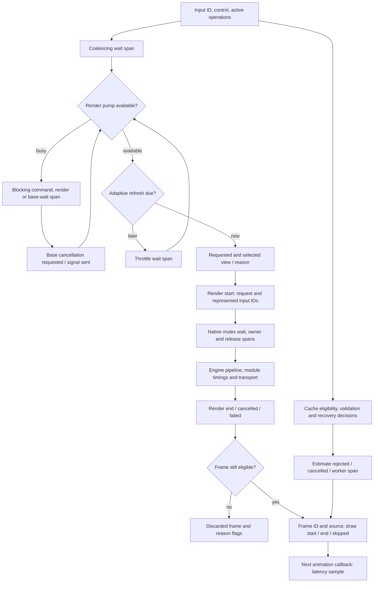

# GUI performance tracing

The existing [slider sequence](diagrams/slider-sequence.svg) describes the
three-process rendering flow. This diagram shows the diagnostic points:



## Collection

Run the existing GUI benchmark in Preferences → Performance → Measuring. Report
schema 8 includes diagnostics by default, independently of the overlay. For an
overhead comparison, set `localStorage.setItem("immage.perfDiagnostics", "0")` in
the webview developer console before a run; set it to `"1"` to restore diagnostics.
This leaves legacy timing, resource and frontend-work metrics enabled. Alternate
multiple on/off runs with fixed photo, edits, viewport, display and preferences.
Unit tests do not establish profiler overhead on a user's hardware.

## Report fields

- `build`: compile-time Git commit and tracked-dirty state, or null when metadata
  is unavailable. A dirty commit does not uniquely identify source contents.
- `diagnostics.events`: frontend `performance.now()` timestamps and monotonic IDs.
  At most 30,000 events are kept. `droppedEvents` and `unfinished` expose gaps.
- `diagnostics.native`: up to 30,000 engine-mutex spans on an independent native
  clock, with wait, acquisition and release markers, operation names, render
  request IDs, dropped counts and unfinished operations. The release marker
  precedes guard destruction; tracing/unlock overhead can remain unattributed.
- Sample `diagnostic`: frame ID, request ID where applicable, first/latest
  represented input IDs, first-input timestamp, source and dispatch-phase label.
  Sources are `native`, `engine-reuse`, `local-reuse` and `estimated`.
- `latestInputLatency` / `oldestInputLatency`: callback time minus represented
  input timestamps. New input during rendering is not represented in that frame.
  Legacy `total` retains its existing start: the native batch's oldest input or
  an estimate's latest input. Legacy labels and tuner metrics remain unchanged.
- `moduleTimings.status`: pending, complete or unavailable. During diagnostics,
  timings are retrieved by request ID so a later render cannot replace the
  frame's module costs. The bounded pending-module store reports evictions as
  `droppedModuleTimings`.

`command` spans identify auxiliary calls. Commands awaited by the pump carry
`blockingPump`; concurrent saves do not. Coalescing, base waiting and adaptive
throttling have separate elapsed spans. Render events record geometry and
input attribution. `preview.decision` / `preview.selected` explain size changes.
Cache events show replacement, validation results, recovery state and rejected
estimates. Estimate-worker spans include off-thread waiting, not just compute.
Shared-transport events identify retries and failures. Hooks do no console logging.

Cancellation request and signal-sent events are separate. Signal-sent means the
cancel command was written, not that rendering stopped. Render cancelled/end
outcomes and native release spans show completion; stale completed base frames
are explicitly discarded.

## Analysis and timeline export

```bash
python3 -I benchmarking/diagnose.py /path/to/gui-report.json \
  --json /tmp/gui-analysis.json --trace /tmp/gui-trace.json
```

Older reports remain readable. The analyzer separates first frame, sustained drag
and release by phase, source and actual dimensions; P95 uses nearest rank. Grouped
frame intervals may skip intervening frames of another source or size, so they
are not the tuner's whole-phase FPS measurement.

Slow frames include stages, largest module costs, frontend queue blockers and
native lock owners. Blocker intervals can overlap: covered time uses their union,
and uncovered time remains unattributed. Dropped/unfinished spans reduce coverage.
The analysis also includes cancellation completion delays and frame/estimate
outcome counts.

`--trace` writes separate Chrome trace-event files for Perfetto or Chrome's trace
viewer: the frontend file and a sibling `gui-trace.native.json`. Their clocks are
not aligned; request IDs connect them. Frontend lanes show elapsed asynchronous
operations, not CPU-execution tracks.

## Measurement boundaries

The native trace covers every acquisition of the app's main engine mutex,
including auxiliary commands. Tagged thumbnails, imports, exports and AI jobs use
separate engine threads outside that mutex. Their hardware contention cannot be
proven from mutex ownership alone.

The legacy `paint` field measures the next animation callback, not actual screen
presentation or input-to-photon latency. Those need platform profiling or external
measurement. CPU/GPU saturation and memory-bandwidth contention also need platform
profiling; recorded waiting and module wall times establish where to investigate.
