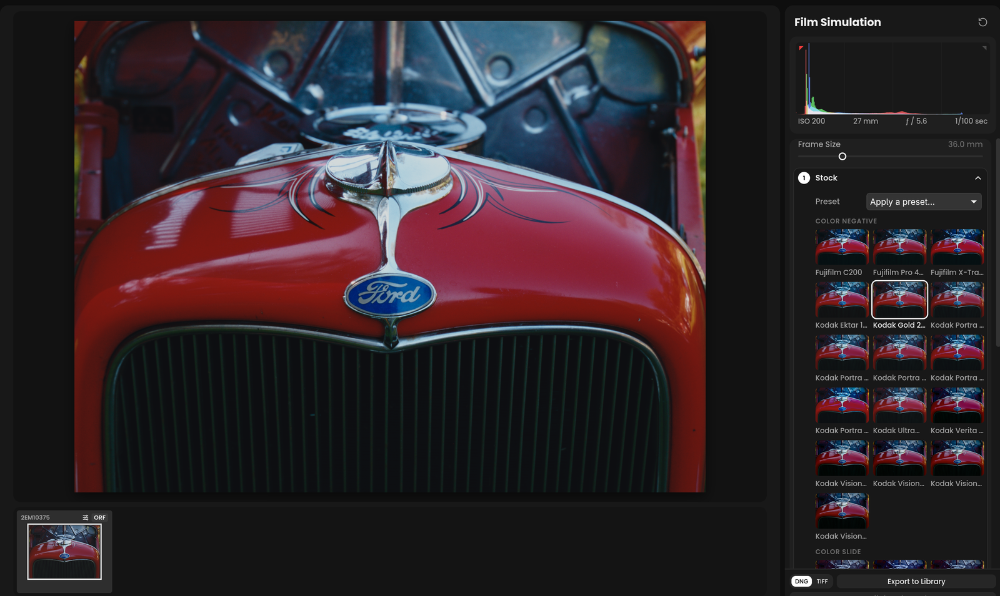

# Film Simulation

Film Simulation renders a photo the way a film would. The photo's light
exposes a film stock, which is developed, then either printed on a paper
or scanned directly. It uses darktable's spektrafilm module by Andrea
Volpato. The module works from measured data of real films and papers, so
it produces their color, contrast, grain and halation, not just an
imitation of their look.

Open it from the right-hand rail with the film canister icon, below the
Zone System.

## The film data

The film and paper measurements are not part of Immage. If they are not on
your computer yet, the panel's first step, **Convert**, holds **Download Film
Data**. The download is about 12 MB and happens once. The step shows its
progress, with **Cancel** while it runs and **Try Again** if it fails. The
data is saved in darktable's own data folder
(`~/.local/share/darktable/spektrafilm` on Linux), so darktable on the same
computer uses the same copy, and so does a copy you installed there by hand.

The data comes from the darktable-spektrafilm repository and is licensed
under CC BY-SA 4.0.

## Converting the photo

Once the film data is on your computer, the **Convert** step holds
**Convert to Film**. It switches the module on with darktable's defaults:
Kodak Gold 200, printed on the paper made for it. Below it, the **Start
from a preset…** menu converts the photo with one of darktable's built-in
spektrafilm looks instead, so you start from that look rather than the
defaults.

Until the photo is converted, the other steps are listed but locked. Once it
is converted, the Convert step goes away and **Stock** opens, and the **Frame
Size** slider appears at the top of the panel.

Film Simulation takes the tone mapper's place: AgX or sigmoid switches
off, and so does a filmic or base curve from darktable. Exposure, white
balance and color calibration stay on, because they set the light the film
sees. Get the exposure right first: the film's response depends on where
middle gray lands.

While Film Simulation is on, Basic's **Contrast** and **Saturation** run on
color balance rgb, and **Blacks** on exposure. **Whites** and **Profile**
are greyed out, because they belong to the tone mapper.

## The panel

The panel is a list of numbered steps. One step is open at a time, and the
others fold to a line that shows their current values. Click a folded step
to open it. The open step has **Back** and **Next**, and **Done** on the
last one, which folds them all. A step you have been through shows a check
mark. Immage remembers the open step, so the panel opens where you left it.

**Frame Size** sits above the steps, at the top of the panel, once the photo
is converted. It is the long edge of the film frame: a smaller frame enlarges
the grain and halation more.

The steps are:

- **Stock**: the **Preset** menu, which applies one of darktable's film and
  look presets. A preset sets every control below, including the film and
  paper, and the menu keeps showing the preset you applied last. Under it,
  a tile for each film stock, grouped as color negative, color slide, and
  black and white. Each tile shows a small render of the current photo with
  that film, refreshed as you edit. Hold the pointer over a tile, film or
  paper, to preview it over the photo at the size the photo is shown at, so
  grain and detail look as they will once chosen; moving away puts the photo
  back. Choosing a slide film scans it directly,
  with its black and white points fitted. Choosing a negative goes back to a
  print.
- **Paper**: tiles for **Auto**, which follows the film's own print stock and
  names it in its tile, and **None: scan the film**, which skips the print and
  shows the developed film. Below them, a tile for each paper, each rendered
  with the chosen film. A slide film has no print, so this step is listed but
  cannot be opened.
- **Exposure**: Film Exposure and Push / Pull for the film; and, for the
  print, Print Exposure, Auto Print Exposure and Print Contrast. Brightness
  is here too. The print controls are hidden while the film is scanned.
- **Color**: the enlarger's magenta and yellow filtration, the darkroom's way
  of correcting a print's color. It is hidden while the film is scanned.
- **Grain & Halation**: grain strength and size, and the red glow halation
  puts around bright edges.
- **Darkroom**: the last step, always listed. It holds the rest of darktable's controls, in folds that follow its tabs:
  Development, DIR Couplers, Lens Diffusion, Print, Print Diffusion, Grain,
  Halation, Scanner and Color Science. The Print folds are hidden while the
  film is scanned. Each control's tooltip gives darktable's name for it. Its
  summary ends with "changed" when any of these settings has been edited.

Film Simulation is slow to render, especially with grain and halation on,
so sliders can lag behind your drags.

## Export a positive to the library

Below the panel, **Export to Library** saves a separate copy beside the
original, `<name>-film.dng` or `.tif`, with the simulation and your other
edits baked in. The copy opens with a neutral starting edit, so the
normal tools work on it without applying the film again. The **DNG** and
**TIFF** buttons choose the format. This is the same setting as
Preferences › **Generated positive format** and the Negative panel's
format. The copy opens automatically unless **Open generated photos** is
off.

**Turn Off Film Simulation**, below the panel, puts the photo back on its
tone mapper, with Basic's tools as they were. The film settings stay with the photo: turning
the simulation back on in the same session restores them.

## With negatives

A photo is either a film simulation or a converted
[negative](negative.md), not both. Turning one on while the other is on
asks first, then turns the other off.

## Copying to other photos

Copy… in the right-hand panel lists **Film Simulation**. It starts
unticked, like Negative and Crop. Pasting it onto other photos turns the
simulation on for them with the same settings.

## In darktable

The edit is darktable's spektrafilm module with the tone mapper switched
off. darktable of the same version, with the same film data, opens it the
same way.
