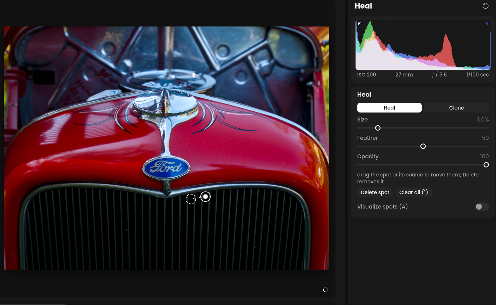

# Heal, clone, fill and blur

Remove dust spots, blemishes and distractions, even out a color blotch, or
soften part of a photo.

**If you've used another editor:** this is spot removal, Q to open it,
with a visualize-spots view on A. Immage picks the source for you, and you can move it.

Open it with **Heal** on the rail, or Q.

<!-- screenshot: Heal mode, one spot selected showing its source outline and link line -->

## Removing a spot

The pointer is the brush: its outer circle is the patch's size, the inner
circle where its feather starts, and the dot its center.

- **Click** a spot to cover it with a round patch.
- **Drag** along a line, such as a wire, to paint over it.

While you press and drag, the area being healed shows in the mask overlay
color, with the brush's outer circle guide following the pointer so you can
see the brush size while painting. The overlay disappears when you release;
the outer circle remains as the pointer guide while it is over the photo.

Immage finds a source for the patch: the area that best matches the
spot's surroundings. It shows as an outline linked to the spot.

- Drag the spot to move it.
- Drag the source to move just the source.

## Heal, clone, fill or blur

- **Heal**: copies texture from the source, matched to the spot's color and
  light. Best for most spots.
- **Clone**: copies the source exactly as it is. Best where heal blends in
  the wrong tone, such as along an edge.
- **Fill**: paints the spot with a color or a flat tone, with no source.
  Used with **Color only** (below), it evens out redness or another color
  blotch on skin while keeping the light and texture of the photo.
- **Blur**: softens the spot, with no source.

## Settings

- **Size**: 0.2-20% of the photo.
- **Feather**: 0-100, how soft the patch's edge is.
- **Opacity**: 0-100.

Click a spot on the photo to select it, or check several under **Select
spots** in the Heal panel. Size, Feather and Opacity apply to the whole
selection in one Undo step per adjustment. The most recently selected spot
sets which controls are shown. Fill and Blur controls apply to the
selected spots of that type. Settings also become the brush's settings for
new spots. The mode buttons switch selected spots within their pair (Heal
and Clone, or Fill and Blur). Choosing a mode from the other pair than
the most recently selected spot clears the selection and changes the brush.
**Delete selected spots** removes the whole selection.

### Fill

- **Fill with**: **Color** paints the spot with a color. **Erase** paints a
  flat neutral tone, set by **Brightness**, not a transparent hole.
- **Color**: the swatch shows the stored replacement color. Activate the
  eyedropper and click the photo to sample a point, or drag a box to take
  its average color. The pick sets the color for selected Fill spots and
  for new strokes. A new spot made without a pick takes the average color
  from where you paint it. Sampling works within the visible crop.
- **Hue** and **Saturation**: fine-tune the stored replacement color
  while keeping its HSL lightness. Each selected Color Fill spot keeps its
  own lightness and the color setting you left untouched.
- **Brightness**: -100 to 100, added to the color.

### Blur

- **Type**: **Gaussian** is a plain blur; **Bilateral** keeps edges.
- **Radius (px)**: 0.1-200 pixels of the full-size photo.

## Fill and blur settings

A photo's fill and blur spots share one set of settings, which appear when
Fill or Blur is chosen or the photo has such a spot. They do not change
heal or clone spots. They apply to every fill and blur spot on the photo.

- **Affects**: **Color only** changes the color and keeps the photo's light
  and texture, the default. **Color and tone** also changes the tone.
- **Strength**: 0-100, how much of the fill or blur shows. Click the eye
  beside Strength to temporarily hide Fill and Blur while comparing the
  photo. Click it again or leave Heal to show the effect. Heal and Clone
  stay visible, and the comparison leaves saved edits and exports intact.
- **Limit to color**: restricts the spots to a range of color inside them.
  **Off** applies everywhere; **Range** takes a hue, a hue width, a minimum
  chroma and a smoothness, like a mask's color range, and the eyedropper sets
  them from the visible photo, including after cropping. **Custom** limits
  with darktable's parametric channels, as a mask's parametric component
  does (without its pickers).
- Hover over the **Limit to color** controls to see a yellow overlay across
  the photo. A stronger tint shows a stronger match. Click the eye to keep
  the overlay visible while you use the eyedropper or adjust the range.
  Press **O** to show or hide the overlay.
  The preview shows where the colors match, even outside your spots. The
  fill or blur itself still applies only inside the spots.

To even out skin redness: choose Fill, drag a circle over the blotch with
**Color** and a skin color picked beside it, leave **Affects** on **Color
only**, lower **Strength** to taste, and limit it to the red hues with
**Limit to color**.

The settings are saved with the photo as a second retouch module named
"fill and blur", which darktable shows beside the first.

**Delete spot** removes the selected spot; **Clear all** removes every
spot.

## Show Spots

**Show spots** chooses which spots appear on the photo:

- **Always**: every spot, each as a pin you can click to select.
- **Selected**: only the selected spots and the active spot’s source.
- **Never**: no spots, to judge the retouch, such as on skin.

H hides the spots, and pressing it again brings back your earlier choice.
A hidden spot can't be clicked, so clicking there heals a new spot. The
choice is remembered.

## Visualize Spots

A, or **Visualize spots**, shows the photo as an edge map where dust stands
out. **Threshold** sets how much shows.

## Keys

| Key | Action |
| --- | --- |
| Q | Heal, clone, fill and blur |
| [ ] | Brush size |
| Scroll | Brush size; ⇧-scroll its feather |
| Space-drag | Pan a zoomed-in photo, without moving a spot |
| A | Visualize spots |
| H | Hide the spots, or show them again |
| Delete | Remove the selected spots |
| Esc | Cancel the eyedropper or clear the selection |
