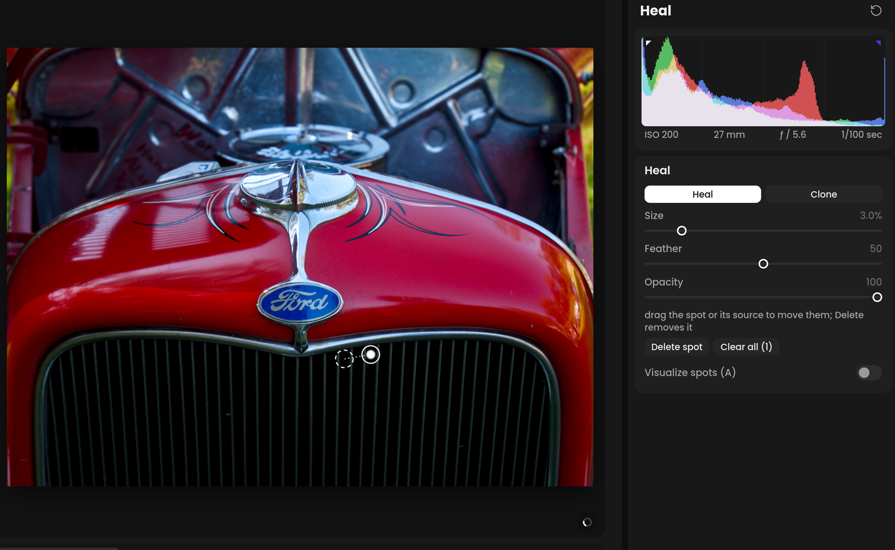

# Heal and clone

Remove dust spots, blemishes and distractions.

**If you've used another editor:** this is spot removal, Q to open it,
with a visualize-spots view on A. Immage picks the source for you, and you can move it.

Open it with **Heal** on the rail, or Q.

<!-- screenshot: Heal mode, one spot selected showing its source outline and link line -->

## Removing a spot

The pointer is the brush: its outer circle is the patch's size, the inner
circle where its feather starts, and the dot its center.

- **Click** a spot to cover it with a round patch.
- **Drag** along a line, such as a wire, to paint over it.

While you press and drag, the area being healed shows in the mask overlay
color. The overlay disappears when you release.

Immage finds a source for the patch: the area that best matches the
spot's surroundings. It shows as an outline linked to the spot.

- Drag the spot to move it.
- Drag the source to move just the source.

## Heal or clone

- **Heal**: copies texture from the source, matched to the spot's color and
  light. Best for most spots.
- **Clone**: copies the source exactly as it is. Best where heal blends in
  the wrong tone, such as along an edge.

## Settings

- **Size**: 0.2-20% of the photo.
- **Feather**: 0-100, how soft the patch's edge is.
- **Opacity**: 0-100.

With a spot selected, the settings change that spot. They are also kept
for the next one.

**Delete spot** removes the selected spot; **Clear all** removes every
spot.

## Show Spots

**Show spots** chooses which spots appear on the photo:

- **Always**: every spot, each as a pin you can click to select.
- **Selected**: only the selected spot and its source.
- **Never**: no spots, to judge the retouch, such as on skin.

H hides the spots, and pressing it again brings back your earlier choice.
A hidden spot can't be clicked, so clicking there heals a new spot. The
choice is remembered.

## Visualize Spots

A, or **Visualize spots**, shows the photo as an edge map where dust stands
out. **Threshold** sets how much shows.

## Keys

| Key | Action |
| --- | --- |
| Q | Heal and clone |
| [ ] | Brush size |
| Scroll | Brush size; ⇧-scroll its feather |
| Space-drag | Pan a zoomed-in photo, without moving a spot |
| A | Visualize spots |
| H | Hide the spots, or show them again |
| Delete | Remove the selected spot |
| Esc | Deselect the spot |
