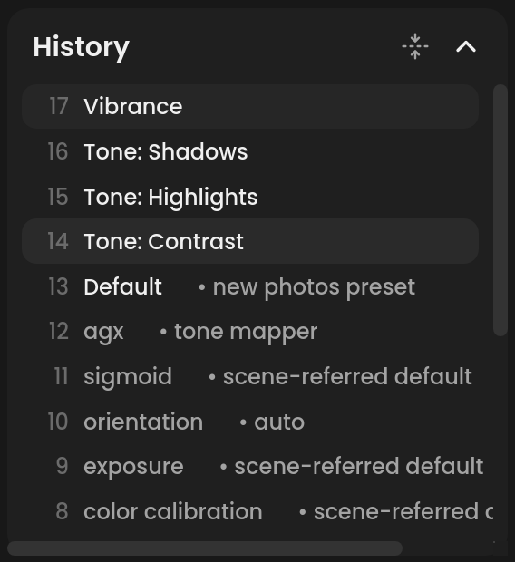

# History, undo and copying settings

Every edit is a step you can undo, and any part of an edit can be copied
to other photos.

**If you've used another editor:** the History card is the usual history
panel, and Copy / Paste / Previous are the usual copy settings, paste
settings and paste settings from the previous photo, with the usual keys.

## Undo and redo

⌘Z undoes the last edit; ⇧⌘Z redoes it. The undo and redo buttons in the
toolbar under the filmstrip do the same. A continuous slider drag counts as
one step.

## The History card

The **History** card in the Library panel lists the edit, newest at the
top:

- this session's steps, named after what changed, such as
  **Exposure** or **New mask**. Click one to go back to it; steps above it
  turn gray, and redo brings them back.
- below them, what the photo opened with: **original**, any edit from
  darktable or an earlier session, and what Immage started it with (the
  tone mapper, profile, the new-photos preset, Auto).

The eye button hides modules that are in the history but switched off.

Pointing at a row of what the photo opened with shows its buttons:

- for a module Immage has no sliders for, such as one added in
  darktable: a **switch**, which turns it off or on again, and
  **delete**. A deleted module is switched off and gone from the history
  once the photo saves. darktable starts every photo with some modules,
  and those come back if removed, so deleting one of them puts it back to
  darktable's defaults instead.
- for a module behind Immage's sliders, such as exposure: **reset**,
  which puts those sliders back where a new photo starts. Moving the
  sliders is how to change it, so it has no switch of its own.

Modules every photo needs, such as demosaic, and the modules a mask
uses (the Masks panel's) have no buttons. Each of these is one undo step.

The compress button, beside the eye, is darktable's **compress history
stack**: the session's steps fold into the photo's history, which then
lists each module once, as darktable stores it. Steps you have undone are
dropped, and the steps before cannot be undone any more. Immage saves the
history compressed in any case, so the photo's sidecar stays small whether
you press it or not.

<!-- screenshot: Library panel, History card open, several steps above the opening stack -->

## Reset all

**Reset all**, in the Adjustments panel's head, takes the photo back to its
starting point: sliders, crop, look, masks and spots. It is one step, so
⌘Z brings everything back.

## Copying settings to other photos

The buttons at the bottom of the right panel:

- **Copy…** (⇧⌘C) opens **Copy Settings**: tick what to copy, then copy
  it.
- **Paste** (⇧⌘V) pastes those settings onto the selected photos in the
  grid or filmstrip. A single selection is also the target, even if another
  photo is open. Without a selection, Paste uses the open photo. The open
  photo and selection stay in place.
- **Previous** (⌥⌘V) pastes the previous photo's settings, the parts ticked
  in Copy Settings.

**Copy Settings** groups: **Profile**, **Treatment**, **White Balance**,
**Tone**, **Presence**, **Tone Curve**, **HSL / Color**, **B&W Mix**, **Color
Grading**, **Sharpening**, **Profiled Denoise**, **Lens
Corrections**, **Transform**, **Post-Crop Vignetting**, **Grain**,
**Crop**, **Look** and **Masks**. **Crop** and **Masks**
start unticked. Your choice is remembered.

Only the groups ticked in Copy Settings change; other edits stay as they
were. **Look**, ticked by default, includes the film style's own module
settings and **Look amount**. It reapplies the saved style definition, rather
than copying manual changes to its individual History instances. The style
file must remain available. **Masks**, when ticked, replaces the target's
masks; **Crop** and **Negative** also need to be explicitly ticked.

Virtual copies are independent targets. Paste does not automatically include
an unselected RAW/JPEG partner. Remote results that have not been opened into
the local library are skipped and counted in the status message.

Each paste is one step: ⌘Z undoes it, and ⇧⌘Z redoes it. A batch step restores
all of its targets, including their native look and mask settings. Undo is
part of the current photo's editing history; switching photos or compressing
history clears it, as with other editing steps. Previous remains a single-photo
action. Paste requires an open photo and is unavailable while cropping.

A progress overlay prevents editing or navigation during a batch. Immage saves
each target's XMP sidecar and refreshes its thumbnail. If a target fails, the
batch attempts to restore all targets. If recovery cannot write a sidecar,
the status reports it and Undo can retry recovery once the problem is fixed.
Undo/redo refuses a batch if a target's saved edit has since changed outside
that step; it does not overwrite the newer edit.
