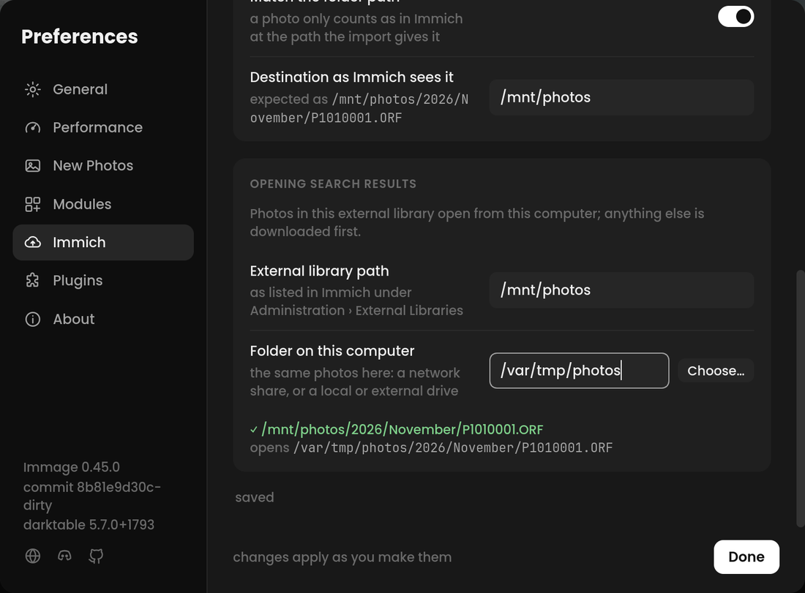

# Immich

[Immich](https://immich.app) is a self-hosted photo library. Immage uses it
in three ways:

- **Importing** asks Immich whether each new photo is already there and marks
  the ones it is. Immage does not send imported photos to Immich.
- **Searching**, from **Find** in the toolbar, finds
  photos by what is in them, by people, places, tags or albums. You then
  edit them as if they were local.
- **Exporting** can upload straight into an Immich album.

**If you've used another editor:** Immich takes the place of an editor's
catalog and collections, and of publishing to a photo service. Immage itself keeps
no catalog.

Immage works with Immich 3.2 or newer.

## Setting it up

### 1. Make an API key in Immich

In Immich's web page, open **Account Settings › API Keys** and create a
key. Give it the permissions for what you want to do:

| Permission | Needed for |
| --- | --- |
| `asset.read` | checking imports against the library, and searching it |
| `asset.view` | thumbnails of search results |
| `asset.download` | downloading a result's original to edit it |
| `asset.upload` | exporting to Immich |
| `album.read` | listing albums to export to, and the Albums search filter |
| `album.create` | creating an album from the Export dialog |
| `albumAsset.create` | adding exported photos to an album |
| `person.read`, `tag.read` | the People and Tags search filters (optional) |
| `library.read` | listing external libraries one by one (optional; admin keys only) |

Only `asset.read` is needed to check imports. Copy the key: Immich shows
it only once.
<!-- check: the menu path in Immich's web page for API keys -->

### 2. Enter it in Immage

Open **Preferences** (⌘,) and the **Immich** tab.

- **Use Immich**: enable Immich integration, including import checks, search, and context menu actions.
- **Server URL**: your server's address, for example
  `https://photos.example.com`. A plain `http` address works, but sends the
  key unencrypted.
- **API key**: paste the key. It is kept in the macOS Keychain (the
  Windows Credential Manager, or your system keyring on Linux), never in a
  file. Once stored, the field shows **stored**, with **Replace** and
  **Forget**.
- **Self-signed certificate**: turn on if your server uses a certificate
  no authority signed.

Click **Test** beside **Connection**. A good result reads like
`Immich 3.2.1, key "Immage"`. If the key lacks something, the result says
what exporting or searching needs. Add those permissions to the key in
Immich and test again.

Settings save as you type.

The API key belongs to the server it was saved for. If you change the
**Server URL** to a different server, enter that server's key too: saving the
new address without a key is refused with a message. Changing **Self-signed
certificate** also asks for the key again. Immage does not follow redirects,
so if your server redirects (for example from `http` to `https`), enter the
final address; otherwise Immage tells you the server redirected the request.
Existing setups keep working without entering the key again.


<!-- screenshot: Preferences > Immich, Server card filled in, Test result showing the version and key -->

### 3. Duplicates during import (optional)

- **Match the folder path**: a photo only counts as already in Immich if
  Immich has it at the path the import would give it. Leave it off to match
  anywhere.
- **Destination as Immich sees it**: the import destination's path inside
  Immich, for example `/mnt/photos`. The importer only copies photos to its
  destination folder on disk. Immich sees them only if it scans that folder
  as an external library, so this path is the one the duplicate check asks
  Immich about when **Match the folder path** is on. After a test, a
  **Use …** button can fill it in from a photo on the server.

How the paths line up when **Match the folder path** is on:

```
This computer                          Immich server
─────────────                          ─────────────
Import destination                     Destination as Immich sees it
/Volumes/photos            ── scanned as an external library ──>  /mnt/photos
  └ 2026/November/IMG_0412.CR3           └ 2026/November/IMG_0412.CR3
                                            already there: counts as a duplicate
```

### 4. Opening search results (for external libraries)

If Immich reads photos from a folder this computer also has (an external
library), Immage can open those files directly instead of downloading them.
Only one external library can be mapped. Photos uploaded to Immich always
download.

- **External library path**: the library's folder as Immich sees it on the
  server, for example `/mnt/photos`, as listed in Immich under
  Administration › External Libraries.
- **Folder on this computer**: the same photos here: a network share, or a
  local or external drive. Click **Choose…**. Folders inside it are always
  treated as network shares: when the share isn't mounted, Library shows them
  as offline (a red dot on the drive heading) instead of as empty folders.

For example, with **External library path** `/mnt/photos` and **Folder on this computer** `/Volumes/photos`:

```
Immich server                          This computer
─────────────                          ─────────────
/mnt/photos/2026/November/IMG_0412.CR3  ──>  /Volumes/photos/2026/November/IMG_0412.CR3
                                              ✓ opens directly
/mnt/other/2025/DSC_1180.NEF                 ✗ downloads: outside the external library path
/data/upload/…/IMG_0999.JPG                  ✗ downloads: uploaded to Immich, not in the library
```

Left blank, a field borrows the importer's value: the external library path
borrows the destination as Immich sees it, and the folder on this computer
borrows the import destination. The borrowed value is shown under the field
("using the destination's: …" or "using the import destination: …"), so you
can see what is in effect. If the folder on this computer is blank and the
importer has no destination either, a warning says results will download
instead of opening. If the folder is set but cannot be reached (for example a
drive that is not connected), the warning "not available right now" appears.

Below the fields, an example line shows how a result opens: a sample server
path (from the last **Test**, else built from the external library path and
the importer's folder template) with a check mark and the file it opens on
this computer, or a cross and why it would download: no folder on this
computer, the folder is not reachable, or the path is not inside the external
library path.

Photos outside that library are downloaded before they open. Only photos
opened from the mapped folder can be denoised with AI Denoise, since the DNG
is written beside the raw.

## Searching

Immich search is part of **Find**, the grid's search and filter panel. After
configuring an Immich server and key, **Search in** offers **Immich** and
**Both** (this computer's photos and Immich together) besides **This folder**
and **All folders**. Local search remains available without a server; see
[Library](library.md#find).

<!-- screenshot: the Find panel in the grid, Search in set to Immich, Smart search "sunset on a beach", the Immich library picker visible, the People filter open under its row with one person ticked -->

- The **Immich library** picker chooses what to search: **External libraries**
  (the default), **All photos**, or one library.
- Type in the search box; it searches as you pause or press Enter. **Smart**
  searches by what is in the photo, using Immich's machine learning, for
  example `dog on a beach`. **Filename** searches file names and descriptions.
- Find's filters narrow the search: the date taken, rating, **Favorites**,
  **RAW only**, camera and lens, keywords (Immich's tags), **People**,
  **Albums**, and **Place** (country and city). Immich applies them to the
  whole search, not just the results loaded so far, and they take effect as
  you set them. In an Immich-only search, **Camera**, **Lens** and
  **Keywords** list the server's values.
- Filters that exist only on this computer, such as **Camera body**,
  **Exposure** or flags, hide Immich results in a **Both** search; the filter's
  row says so.
- A [saved filter](library.md#saved-filters) can search Immich. When Immich
  is not available, it searches this computer only and says Immich was
  skipped.

Results fill the grid, up to 250 per source page, with more as you scroll.
Photos in the Immich trash are not shown.
Combined queries display successful sources independently and retain the other
source’s results if one fails. The status line reports each source’s error.
Unknown local-only filter fields exclude remote results. Exact verified mapped
local paths merge with primary local results; virtual copies remain separate.

When a library folder is mapped under **Opening search results** (or via the
importer's path settings) and Immich answers with Smart Search enabled, Immage
routes **Smart** searches in **This folder** and **All folders** to Immich and
skips local CLIP background analysis for all photos in that folder (while still
caching local EXIF/XMP metadata for local filters). Precedence per folder is
**morfPhoto**, then **Immich**, then **local CLIP**; if Immich does not answer
or has Smart Search turned off, Immage falls through immediately to local CLIP.

## Opening a result

Double-click a result to open it. If the file is in the folder set under
**Opening search results**, Immage opens it in place and saves the edit beside it,
like any other photo. Otherwise it downloads the original first ("downloading
the original from Immich…") and edits the downloaded copy.

To find picked photos from Immage, choose the `Pick` tag in Immich’s
advanced search, or under **Keywords** in Immage’s Immich search. For
external libraries, Immich needs to discover new XMP sidecars and sync
those that changed. For exports sent to Immich, keep **Keywords** enabled
in Export’s Metadata section. Immich gives its own sidecar tag list
priority when that field is present. [Immich XMP sidecars](https://docs.immich.app/features/xmp-sidecars/)

Until a result is opened, its stars show Immich's rating and can't be
changed. After that, ratings and labels go into the photo's sidecar.

To find the photos you have edited in Immage with Immich's Tags filter, set
**Keywords for edited photos** in Preferences › New Photos. Immich sees a
keyword once it reads the sidecar again, at its next library scan or
metadata refresh.

Right-click a result for **Show in Immich**, or **Show Results in Immich** (available for Immich and Both searches when Immich is configured and enabled in Preferences) to see the same search in Immich's web page. Immich context menu items are hidden when Immich is not configured or disabled.

With a server URL and API key configured in Preferences, choose
**Import Parent Folder** to add the result's containing folder to
**Folders** and browse its photos in the grid. An existing library folder
expands to show it; otherwise the folder is added to the library. This uses
the local file set up under **Opening search results**, without copying files.
The action is disabled when the result has no available local file;
downloading an original does not provide access to its server folder.
Browsing follows your **Include Photos from Subfolders** setting.

## Copying results into a folder

Drag a result onto a folder in the **Folders** card to copy it there (see
[Moving and copying photos](library.md#moving-and-copying-photos)). Results
are always copied, never moved, and Immich keeps its photos.

- **On this computer.** A result whose file is in the folder set under
  **Opening search results** is copied from that file, with its XMP sidecar.
- **Not on this computer.** Otherwise the original is downloaded into the
  folder. For a photo uploaded to Immich, the download is checked against
  Immich's own checksum. A photo in an external library is checked by
  reading it back, since Immich's checksum for those may not be of the
  file's content.

## Exporting to an album

In the Export dialog, set **Save to** to **Immich album**, then choose an
album, or **New album…** to make one. A photo Immich already has goes into
the album without a second copy. See [Export](export.md).

## When something goes wrong

| Message | What to do |
| --- | --- |
| **could not connect: …** | Check the server address and that the server is up. For a self-signed certificate, turn on **Self-signed certificate**. |
| **the key lacks asset.read** | Edit the key in Immich and add the permission. |
| **Enter the API key for this server. The saved key belongs to a different server.** | You changed the server address: enter the API key for the new server. |
| **Enter the API key again to change the certificate setting** | Enter the API key, then change **Self-signed certificate**. |
| **The server redirected the request. Use its final URL** | Enter the address the server redirects to, for example `https://` instead of `http://`. |
| **the API key lacks …: thumbnails need asset.view, downloading originals needs asset.download** | Add those permissions to the key. |
| **the API key lacks …: give it those in Immich, or exporting may fail** | Add the export permissions (`asset.upload`, `album.read`, `album.create`, `albumAsset.create`). |
| **no photos in Immich match the search** | Loosen the search, or set the library menu to **All photos**. |

Mapped local files must stay inside the configured local folder after resolving
symlinks. Paths that escape that folder are treated as unavailable locally.
