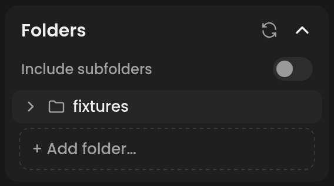
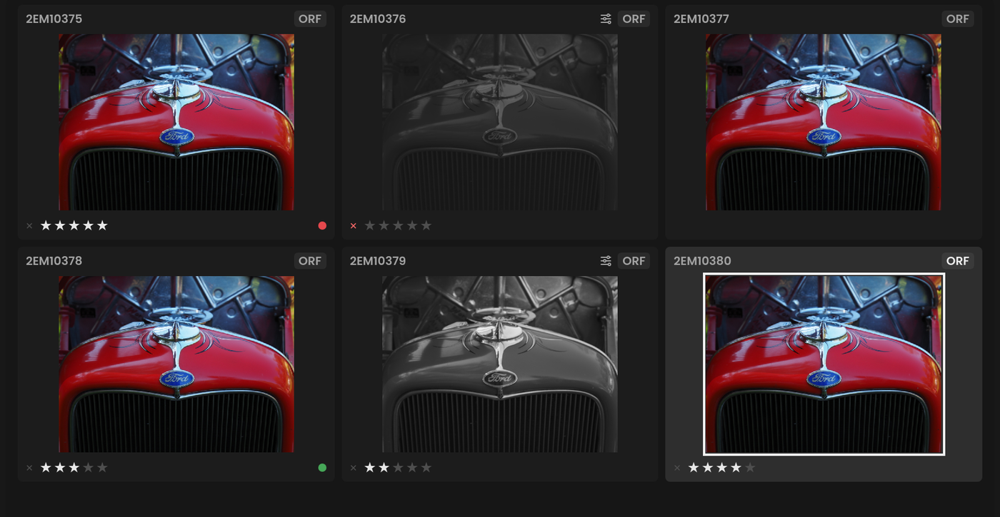

# Library

Immage has no catalog. You add folders, browse them in the filmstrip or the
grid, and rate, label and keyword photos there. Everything you set is
written to the photo's XMP sidecar, so it travels with the photo and
darktable sees it too.

**If you've used another editor:** think of it as a folders panel without
the import step. Adding a folder never copies or moves anything. Collections
and smart collections don't exist; [Immich](immich.md) can do that job.

## Folders

Open the **Folders** card in the **Library** panel.

- **+ Add folder…** adds a folder to the list and opens it in Grid view.
  Dragging a folder from Finder or Explorer onto Immage's window does the
  same.
- Click a folder in the tree to open it. The arrow beside it shows its
  subfolders.
- Hover a folder and click **×** to take it off the list, whether it is
  one you added or a subfolder inside one. A subfolder taken off the list
  is left out of **Include subfolders** too. Its files stay where they
  are; adding or dragging the folder in again brings it back.
- **Include subfolders** shows the photos in a folder's subfolders too.
  It is off unless you
  turn it on.
- The refresh button reads the folders, and the open folder's photos,
  again: use it after adding files from outside Immage.
- The **×** beside a top-level folder takes it off the list. Nothing is
  deleted.
- When the open photo is in a folder you aren't browsing, that folder is
  marked with a dot.
- When your folders are on more than one drive, each drive is a heading
  over its folders, so two folders with the same name (a 2026 on your
  computer and a 2026 on a NAS) are told apart. A network share shows a
  network icon and its server's name, or its address when the share was
  connected by address; double-click the name or address to give it a
  name of your own, and clear it to go back. Click a heading to fold it. A
  folder on a share that isn't connected stays under its share, dimmed.
- A folder on a slow share fills in gradually. Opening another folder, or a
  photo from your own drive, doesn't wait for it: the share's reading stops
  after the file it is on.

Folders you import into join the list by themselves. The list, the open
folder and the last photo are remembered when you quit.


<!-- screenshot: Library panel, Folders card open, Include subfolders off, one folder added -->

## The filmstrip and the grid

The filmstrip under the photo shows the open folder, in the order the
photos were taken. Photos taken at the same moment, such as a raw and its
virtual copies, follow by file name. A photo whose camera recorded no
capture time, as one with a flat clock battery, is placed by the date its
file was last changed; photos with neither come last. Each thumbnail shows
the file name and type (**ARW**, **JPG**, ...), and a small sliders mark
beside the type once the photo is edited. Hover over it to see its rating,
labels and reject button. Once a photo is rated or rejected, those show all
the time.

Thumbnails load in the background and prioritize the photos currently visible
in the grid or filmstrip. Scrolling changes that priority; renders already
running finish before the newly visible photos use their slots.

A photo counts as edited once you change something yourself. What Immage
gives a photo the first time it opens (the **New Photos** settings in
[Preferences](preferences.md)) doesn't count, and undoing every change
makes it unedited again. darktable uses the same rule, and the sidecar
carries it, so its lighttable shows the same photos as altered. Photos
opened in Immage before version 0.23.2 count their New Photos settings as
an edit until you reset them.

Press G, or **Grid** in the toolbar under the filmstrip, for **Grid** view:
the whole folder at once.
Double-click a photo to open it and go back to the filmstrip. G or Esc also
goes back.

Drag the top edge of the filmstrip to make it taller or shorter.


<!-- screenshot: Grid view of a folder, some photos rated, one rejected, one with a label -->

## Selecting photos

- Click a photo to open it.
- ⌘-click adds a photo to the selection, or takes it out, without opening
  it.
- ⇧-click selects the run from the open photo to the one you click.
- ⌘A selects every photo the filters leave showing.
- ← and → step through the photos.

Ratings, labels, rejecting, exporting, virtual copies and Edit In all act
on the whole selection.

## Rating, rejecting and labels

| Key | Action |
| --- | --- |
| 1-5 | rate; 0 clears the rating |
| X | reject, or un-reject |
| 6, 7, 8, 9 | red, yellow, green or blue label (purple has no key) |

You can also click the stars and the **✕** on a thumbnail, or use the
**Metadata** card. Rating a photo un-rejects it.

## Filtering

The toolbar under the filmstrip filters the folder:

- **Stars**: show photos with that rating and up. Click it again to turn it
  off.
- **Reject**: click once to hide rejected photos, again to show only them,
  and again to show everything.
- **Edited** (the sliders button): click once to show only edited photos,
  again to show only unedited ones, and again to show everything.
- **Color labels**: show photos with any of the chosen labels; the gray
  swatch shows photos without a label.
- **Filters**: opens a list of what else the folder can be narrowed by,
  with a panel beside it showing the options of the one chosen. Choose
  as many as you like, then click **Search** to filter the folder and show
  it in the grid; **Clear** in the panel takes that one off, at the next
  **Search**.
  - **Rejected**: **All photos**, **Hide rejected** or **Only rejected**.
    This counts as an active filter and resets with **Clear all**.
  - **File type**, **Camera** and **Lens**: tick any to show photos of
    those, for example **RAW** and **JPEG**. Each lists what the folder
    holds, with how many photos of each.
  - **Camera body**: distinguish physical bodies of the same model by their
    full serial numbers, even when you swap lenses. Entries show the camera
    model, serial and photo count. Tick multiple bodies to include any of them;
    combine with Camera, Lens or other filters to narrow the results. Long
    lists can be searched by model or serial. **Serial not recorded** selects
    photos without a usable body serial; those cannot be assigned reliably to
    a particular body. Serials come from the original file's supported metadata,
    including recognized camera maker notes; lens serials are never used.
    Changes apply with **Search**, and reset with **Clear** or **Clear all**.
    This filter is available for folders, not Immich server searches.
  - **Keywords**: tick one or more to show photos with all of them. A
    keyword includes those under it, so **Places** shows photos tagged
    **Places › Norway** too.
  - **Captured**: photos taken between two dates. Type them, or pick a
    recent span (**Last 30 days**, **This month**, **Last year** and
    others), a year, or a month of the year picked. A photo with no
    capture time goes by its file's date here too.
  - **Exposure**: ISO, aperture, focal length and shutter speed. Choose
    one to list the values the folder holds, and tick any, for example
    ISO 100 and 200.

  Each list counts only the photos your other choices leave: tick a
  camera, and **Lens** lists just the lenses used on it. The list shows
  what each is set to, and the button how many are on. **Clear all**, at
  the bottom of the panel, takes them all off when you click **Search**.
- **Clear**: show every photo again.

Opening another folder clears the filters.

## RAW+JPEG pairs

Turn on **Stack RAW+JPEG pairs as one photo** in **Preferences › General**
to show a raw and the JPEG, HEIF or OM System .ORI of the same name as a
single photo. Its thumbnail reads, for example, **ARW+JPG**. A rating,
reject or delete takes them all.

## Virtual copies

A virtual copy is a second edit of the same photo. Press
⌘', or right-click and choose **Create Virtual Copy**. The copy starts from
the photo's edit as it is, is listed after the original with a folded
corner, and opens. Each copy has its own sidecar.

To remove one, right-click it and choose **Remove Virtual Copy**. Its
sidecar goes to the Trash; the photo file stays.

## Generated photos

Generated photos open for editing automatically, including HDR and panorama
merges. Turn off **Open generated photos** in Preferences › General › Workspace
to stay on your current photo and use the completion notification's **Open**.
Successful notifications close after 30 seconds, or when Open or OK is selected.

## HDR Merge

HDR Merge combines bracketed raws, the same scene at different
exposures, into one photo with the range of them all, using darktable's
HDR merge. Select the brackets in the filmstrip or grid, then press ⌃H
or right-click and choose **HDR Merge…**. Turn on **Auto Align** for
brackets shot handheld, so that they line up before they merge; brackets
from a tripod don't need it. Click **Merge**.

Immage writes a new DNG beside the first bracket, named
`<name>-hdr.dng` (then `<name>-hdr_01.dng` and so on). It is merged in
the background while you go on editing, and **Open** at the bottom left
of the photo opens it. The DNG holds the raw data, not a finished
picture: it opens with the new-photo defaults and is edited like any
raw, with Exposure, Highlights and Shadows bringing the range in. The
brackets themselves aren't changed.

HDR DNGs preserve their format identification, color calibration and sensor
pattern when copying the brackets' EXIF, and can also open in darktable.
Regenerate an older merge if it shows a **?** thumbnail and cannot open.

The brackets must be raws from the same camera, of the same size and
orientation. Anything that moves between them, such as people or
leaves, shows as a ghost: Auto Align lines up the camera's movement,
not the subject's.

## Panorama Merge

Panorama Merge and its projection preview are supported on Windows, macOS and
Linux. Official Windows builds include the OpenCV stitching support needed for
both preview and merge. If the dialog says this build cannot stitch panoramas, its engine lacks
stitching support; install a build that includes it.

Panorama Merge stitches overlapping RAW or non-RAW photos, including mixed
selections, into one wide photo. Select the
photos in the filmstrip or grid, then press ⌃M or right-click and choose
**Panorama Merge…**. A preview of your selected photos appears above the
projection choices. Choose a projection to compare its effect:

- **Auto** picks one from how wide the panorama is
- **Spherical** suits very wide panoramas, and those of several rows
- **Cylindrical** suits wide panoramas, and keeps vertical lines straight
- **Perspective** keeps straight lines straight, for architecture, up to
  about 100° across

With **Auto**, the label below the preview shows the projection chosen.
**Auto Crop** cuts away the empty edges the photos leave; toggle it to compare
the crop immediately. With it off, empty edges appear as a checkerboard.

The preview takes a moment to build and updates when you change projection.
Previously viewed projections are kept while the panel is open. It shows
geometry at reduced resolution; final detail, alignment and color may differ.
If some photos do not overlap, the panel shows how many the preview uses.
If the preview fails, try **Retry** or another projection. You can still click
**Merge** to attempt the full-resolution stitch. Closing the panel cancels
preview work. Previewing does not create a file or change your source photos.

Click **Merge** when you are happy with the projection and crop.

Immage writes a new DNG beside the first photo, named `<name>-pano.dng`
(then `<name>-pano_01.dng` and so on), and lists it after that photo. It
is stitched in the background while you go on editing, and **Open** at
the bottom left of the photo opens it. The DNG holds
linear image data with lens corrections already made. An all-RAW selection
opens with the new-photo defaults, white balance as shot and Lens Corrections
off. A selection containing non-RAW photos uses a common linear color space
and a neutral starting edit. The DNG is edited as one photo. The other edits
of the photos you merged aren't used, and the photos themselves aren't
changed.

Panorama DNGs can also be opened in darktable. RAW merges preserve the DNG's
format identification, camera color matrix and white balance when copying
the source photo's EXIF. If an older RAW merge shows a **?** thumbnail and
cannot open, merge the original photos again with the updated version.

The photos should overlap by a third or so. A photo that overlaps none of
the others is left out, and the activity line says so. Stitching runs on OpenCV rather than darktable,
which has no panorama tool. It takes from half a minute to a few
minutes, and a lot of memory for many photos.

## Deleting rejected photos

Immage only deletes photos you have rejected. Reject them with X, select
them (or show only rejected photos and press ⌘A), then right-click and
choose **Delete Rejected Photo…** (with several, **Delete 3 Rejected
Photos…**). They move to the Trash with their sidecars, after you
confirm. Thumbnails disappear immediately while the files move in the
background. If deletion fails, an error appears and the folder refreshes to
show any files still present.

## The right-click menu

Right-click a photo, or a selection, for:

- **Edit In ›**: send it to another application. See [Edit In](edit-in.md).
- **Create Virtual Copy** / **Remove Virtual Copy**
- **HDR Merge…**, for two raws or more
- **Panorama Merge…**, for two photos or more
- **Adjust Capture Time…** / **Undo Capture Time Adjustment…**
- **Show in Finder**
- **Import Parent Folder**, for an Immich result when Immich is configured in
  Preferences: add its locally mapped parent to Folders and browse its photos.
  Disabled when no local file is available. See [Immich](immich.md).
- **Show in Immich**, for a photo from an Immich search
- **Delete Rejected Photo…**

## Metadata

The **Metadata** card shows the open photo's:

- **File Name** and **Folder**
- **Title**, **Caption**, **Copyright** and **Creator**, which you can edit:
  type, then press Enter or click away. Esc puts back what was there.
- the rating and color label
- what the camera recorded: capture date, dimensions, focal length,
  aperture, shutter speed, ISO, exposure bias, flash, lens, camera and more

### Adjust capture time

Select photos, then choose **Adjust Capture Time…** in the context menu or
Metadata panel. Enter the correct time for the reference photo. The dialog
previews the offset and number of photos; confirm to shift them all by the
same amount, preserving relative timing. Photos without a valid recorded
time are skipped. Changes go to XMP sidecars; original files stay unchanged.
The context menu can undo the last batch after confirmation.

### Location

The Metadata panel's Location section accepts latitude and longitude in decimal
degrees (latitude first). Use Show map to place or drag a pin, then Apply to
save it to the photo's XMP sidecar. Remove location clears GPS coordinates and
altitude in Immage without changing the original photo. An Immage XMP marker
keeps removed camera GPS from returning on reopen; other photo software may
still show GPS embedded in the original. Moving a location clears the old altitude. Coordinate editing works
offline; maps require internet access and no API key. Place-name lookup is not
included.

## Keywords

The **Keywording** card lists the open photo's keywords; click **×** on one
to remove it. To add some, type them separated by commas and press Enter.
Type a hierarchy as `Places > Paris`. Suggestions come from the keywords you
have used before, and **Recent keywords** holds the last few: click one to
add it or take it off.

## Opening a photo from another program

Another application, or Terminal, can hand Immage a photo:

```sh
open -a Immage /path/to/photo.arw
```

Immage shows the photo's folder and opens the photo. Dragging a photo from
Finder or Explorer onto Immage's window does the same, and so should
dropping it on Immage's Dock icon.
<!-- check: dropping a file on the Dock icon, and whether Immage appears in Finder's Open With menu -->
