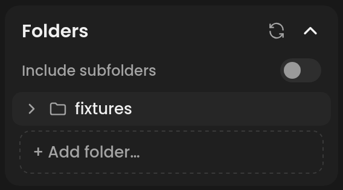

# Library

Immage has no catalog. You add folders, browse them in the filmstrip or the
grid, and rate, label and keyword photos there. Everything you set is
written to the photo's XMP sidecar, so it travels with the photo and
darktable sees it too.

**If you've used another editor:** think of it as a folders panel without
the import step. Adding a folder never copies or moves anything. Collections
don't exist; [Immich](immich.md) can do that job, and
[saved filters](#saved-filters) in Find remember a search and its filters, so
a folder's "smart collection" is one click away.

The grid and filmstrip list photo formats only, including while a folder is
loading. Non-photo files such as `.ACR` and XMP sidecars, documents and videos
do not get placeholder cells. The scan checks whether each photo can be read.

## Folders

Open the **Folders** card in the **Library** panel.

- **+ Add folder…** adds a folder to the list and opens it in Grid view.
  Dragging a folder from Finder or Explorer onto Immage's window does the
  same.
- Click a folder in the tree to open it. The arrow beside it shows its
  subfolders.
- Right-click a folder for **New Folder…**, **Show in Finder** (Explorer
  on Windows, the file manager on Linux) and **Remove from List**.
  **New Folder…** opens the folder and adds a row at the top of its
  subfolders with the name selected: type a name and press Enter, or press
  Esc to cancel. The folder is made on disk, and an existing name is
  refused. You can then drag photos onto it.
- Hover a folder and click **×** to take it off the list, whether it is
  one you added or a subfolder inside one. A subfolder taken off the list
  is left out of **Include subfolders** too. Its files stay where they
  are; adding or dragging the folder in again brings it back.
- **Include subfolders** shows the photos in a folder's subfolders too.
  It is off unless you
  turn it on.
- The refresh button reads the folders, and the open folder's photos,
  again: use it after adding files from outside Immage.
- The **×** beside a top-level folder takes it off the list. Nothing is
  deleted.
- When the open photo is in a folder you aren't browsing, that folder is
  marked with a dot.
- When your folders are on more than one drive, each drive is a heading
  over its folders, so two folders with the same name (a 2026 on your
  computer and a 2026 on a NAS) are told apart. A network share shows a
  network icon and its server's name, or its address when the share was
  connected by address; double-click the name or address to give it a
  name of your own, and clear it to go back. Click a heading to fold it. A
  folder on a share that isn't connected stays under its share, dimmed.
- A folder on a slow share fills in gradually. Opening another folder, or a
  photo from your own drive, doesn't wait for it: the share's reading stops
  after the file it is on. Photos you opened before appear straight away from
  Immage's saved copy; the share's files are checked for changes side by side
  for at most a few seconds, and a file that hasn't answered by then keeps its
  saved copy until you next open the folder. A folder whose listing doesn't come
  back within 10 seconds is reported as not answering.
- A share that stops answering mid-folder doesn't freeze Immage. A file that
  doesn't answer within 5 seconds is skipped, with the rest of that folder for
  30 seconds, so photos on your own drive still open. Open the folder again
  once the share is back to read the skipped files.
- Editing comes first. While you zoom or adjust an open photo, the folder's
  reading and thumbnails slow down and catch up when you pause.

Folders you import into join the list by themselves. The list, the open
folder and the last photo are remembered when you quit.
On startup, the grid appears while the folder is read. If you left a photo
open, Immage switches to it when its first preview is ready. If the photo is
missing or cannot load, the grid stays available so you can choose another.
If the last folder is unavailable, Immage tries your other recent folders.


<!-- screenshot: Library panel, Folders card open, Include subfolders off, one folder added -->

### Cached folder metadata

Immage keeps a disposable local metadata cache, separate from darktable’s
in-memory editing library. Reopening an unchanged folder reuses its ratings,
labels, keywords and camera metadata. Each original and virtual copy keeps
its own editing state. Changed files, sidecars, raster-mask data or copy lists
are read again. An unavailable drive is not treated as an empty folder.

Cached photos enter the editing library when an action needs them: opening,
rendering a missing thumbnail, changing metadata, exporting or managing files.
Existing disk thumbnails can appear without that import. The editing engine
still starts normally; edits and sidecars are read before the action runs.
Verified moves keep cached identities and reusable analysis when source and
sidecar fingerprints still match. Copies receive separate identities, including
when Keep Both changes the filename. Metadata and saved-edit changes invalidate
stale cached results; deleting an original removes its copies from the cache.
At startup, a bounded background scan discovers files and checks existing
records without importing photos into the editor. Metadata for newly discovered
files is filled when they are read. Offline drives, disconnected nested mounts,
excluded folders and incomplete scans keep their cached records. When a drive’s
identity is unknown, browse the folder before missing records can be removed.

A cache failure falls back to reading the folder normally. The cache contains
no originals or authoritative edits and can be rebuilt from your photos.
Metadata caching does not download search models or upload photos; any optional
local analysis model requires an explicit download choice. Downloaded analysis
packages are checked before use, and local analysis runs on the CPU.
**Preferences > Performance > Local photo cache** shows cache and drive status,
pauses background checks, and clears or rebuilds cached records.
**Preferences > General > Smart search (CLIP)** offers the optional model
download and CPU model check, and warns that background analysis uses the CPU
and slows Immage. Clearing preserves model files;
rebuilds wait while background work is paused.

[Find](#find) searches this cache without an Immich connection. Choose
**This folder** (respecting Include subfolders) or **All folders** under
**Search in**. Smart search matches each photo as edited, using its saved edits.
**Filename** and empty-text searches can use cached metadata without a model.
Smart text needs a downloaded model and current indexed embeddings. After you
opt in to the model download, background CPU analysis fills one edited embedding per photo
for photos whose metadata has been cached by browsing. Analysis starts
within a few seconds and respects Pause; existing results remain searchable.
Browsing or reading metadata again refreshes invalidated records for analysis.
After model opt-in, reconciled paths also receive bounded background metadata
imports before analysis, including unvisited folders. Missing or offline files
wait for a later pass. A photo Immage cannot decode, such as a DNG in an
unsupported format, is left out of Smart search until the file changes, Immage
is updated or a month passes. Photos on a network drive are analysed only after two
minutes without opening, editing or browsing photos (reading a folder, or
loading thumbnails in the grid or lightbox), so reading a large file from the
drive seldom holds up the photo you open. A read that is already under way
when you open a photo can still delay it, by up to a minute on a slow drive. Background imports and analysis skip
removed and excluded folders, including work that was queued before the folder
selection changed.
Metadata caching without the optional model still fills
as you browse.

Each source displays results as soon as it finishes. A failure in one source
leaves the other source's results available, with the error in the status line.
More results load independently for each source, preserving metadata changes
and already-opened photos in the displayed results. **Stop** keeps displayed results
and ignores late replies; blocking Immich work may finish in the background,
with at most four active requests. Opening a folder leaves search results.
Combined results use equal reciprocal-rank weighting of each source's order.
A mapped Immich result merges with a primary local result only when its
verified local path exactly matches the indexed path. Virtual copies stay
separate. This identifies the local file path; it does not compare server and
local file contents. Unmapped or differently spelled paths stay separate.
Search retains active filters. Ratings, labels, keyword and capture-time changes
refresh cached search metadata without a folder reload or optional model.
Local queries wait for pending rating saves, while Immich queries can start
independently. Saved editing changes and switching photos queue bounded metadata
refreshes even without an optional model; opening the next photo does not wait
for the previous photo’s metadata read. These queued refreshes wait while
background work is paused. Active grid filters update immediately
when metadata changes. Unknown local edit, reject, label, keyword and
camera-body fields exclude remote results when those filters are selected.

Local search includes cached originals and saved virtual copies, using only
current metadata and model-versioned analysis. Temporary previews are not saved
copy versions. If the photo index changes while a search runs (during
the first indexing, for instance), Immage restarts that search once on its own;
if it changes again, the status line asks you to try the search again.
Selected filters exclude unknown values; capture-date filters do not substitute
file modification dates. Capture metadata retains the source’s fractional digits
and UTC offset when recorded. Dates adjusted in Immage take precedence; an
unknown timezone stays unknown.

In the grid, right-click a local photo and choose **Show more like this**
(offered once the optional model is downloaded).
The clicked photo supplies the image query, independently of the open editor.
The query covers all local library folders, retains selected filters and uses
the photo as edited. An **Image query** indicator names the seed;
**Clear image query** returns to a metadata listing. Missing or stale seed
analysis produces an error rather than substituting another photo. Background
embeddings require the optional model and cached metadata; a photo without
current analysis cannot supply a similarity query.
Similarity queries exclude the source photo and its virtual copies. A changed
cache requires restarting paginated local results. Metadata-only pages stop
once enough matching photos are found instead of ranking the whole library.

### Thumbnail previews

The grid and filmstrip support embedded JPEG and TIFF previews, including
TIFF previews inside DNG photos. If an unedited photo cannot be decoded,
Immage tries a smaller embedded preview before leaving its thumbnail blank.
This fallback can look softer and does not enable editing an unsupported RAW
encoding. Edited photos require a thumbnail that includes their edits.

### ORF metadata reads and library workers

Olympus and OM System ORF photos load their metadata quickly while **Reading
photos** runs, because Immage reads only the start of each file when that is
enough. The number of ORF metadata tasks prepared at once follows
**Preferences > Performance > Memory > Library workers**, the same setting that
sets how many thumbnails are built and photos are moved or copied at once
(default 2). Metadata is still applied in file order. A photo that does not
answer within 30 seconds is reported as unanswered.

## Moving and copying photos

Drag a thumbnail from the grid or the filmstrip onto a folder in the
**Folders** card to move the photo there, for example from your computer to
a NAS. When the photo is part of a selection, the whole selection goes,
and a RAW+JPEG pair goes together. The folder under the pointer is
outlined. Rest on a closed folder for a moment and it opens, so you can
drop into one of its subfolders; this works on the photos' own folder too.
Press Esc to stop dragging. The photos' own folder, and a folder on a share
that isn't connected, don't take a drop.

Hold ⌥ (Alt) as you drop to copy instead, keeping the originals where they
are. You can also choose this in the confirmation.

Nothing happens until you confirm. The confirmation shows the following:

- **The photos.** How many photos go, how much they add up to, and the
  folder they go to.
- **Virtual copies.** A photo with virtual copies takes every version with
  it, since they share its file.
- **Photos already there.** A photo already in the folder with identical
  content (checked by checksum) isn't copied again. A move just removes
  the original, but only when the photo in the folder is a separate copy.
  When the folder is the photo's own folder under another name (a link,
  or the same share mounted twice), the photo counts as already in this
  folder and nothing is removed.
- **Drives that don't answer.** When a photo's drive or share doesn't
  answer, the move or copy stops with a message naming its folder, and
  nothing is moved.
- **Same name, other content.** These photos are listed, each with
  **Skip** or **Keep both**. Keep both gives the incoming photo and its
  sidecars a number (IMG_1000.CR3 arrives as IMG_1000_1.CR3). **Skip all**
  and **Keep both for all** set the whole list.
- **Free space.** A warning appears, and the button is off, when the drive
  doesn't have room.

Each photo goes with its XMP sidecars, every version's, and its mask
sidecars, so its edits, ratings, labels and keywords arrive with it.

Several photos can transfer at once, up to **Preferences > Performance >
Memory > Library workers** (2 by default). Each photo's files stay together;
its sidecars are not separate transfer jobs. The limit is chosen when the job
starts, and also applies when copying originals from Immich. More workers
can help with a NAS or fast disk, but fewer may be quicker on a busy drive.

- **To another drive.** Each file is copied and flushed to the drive. It
  is then read back and checked against the original's checksum before it
  takes its name. A move removes the original only once every file of
  that photo has been verified. A photo whose copy fails or doesn't match
  stays where it was, with nothing left behind in the destination.
- **On the same drive.** A move renames the files, which is instant.

The work runs in the background, under the photo, with a progress bar and
**Stop**. Stopping asks active transfers to stop and leaves queued photos
untouched. Photos already completed stay in the destination. A file operation
already accepted by a drive may finish before it stops. Photos that
are moved disappear from the folder at once.
If any stay behind, the folder is read again to show them. When it's done,
**Show** opens the destination folder.

A transfer that stops answering for 30 seconds ends the job and stops new
transfers. Activity on another photo does not hide a stalled transfer.
Blocked transfers continue to count against the worker cap until they return.

## The filmstrip and the grid

The filmstrip under the photo shows the open folder, in the order the
photos were taken. Photos taken at the same moment, such as a raw and its
virtual copies, follow by file name. A photo whose camera recorded no
capture time, as one with a flat clock battery, is placed by the date its
file was last changed; photos with neither come last. Each thumbnail shows
the file name and type (**ARW**, **JPG**, ...), and a small sliders mark
beside the type once the photo is edited. Hover over it to see its rating,
labels and reject button. Once a photo is rated or rejected, those show all
the time.

Thumbnails load in the background and prioritize the photos currently visible
in the grid or filmstrip. Scrolling changes that priority; renders already
running finish before the newly visible photos use their slots.

A photo counts as edited once you change something yourself. What Immage
gives a photo the first time it opens (the **New Photos** settings in
[Preferences](preferences.md)) doesn't count, and undoing every change
makes it unedited again. darktable uses the same rule, and the sidecar
carries it, so its lighttable shows the same photos as altered. Photos
opened in Immage before version 0.23.2 count their New Photos settings as
an edit until you reset them.

Press G, or click **Library** on the rail at the right edge, below
**Import**, for **Grid** view: the whole folder at once.
Double-click a photo to open it and go back to the filmstrip. G, Esc or the
**Library** button also goes back. The **Library** button is highlighted while
the grid shows.

In the grid the right-hand panel is **Find** (see below), locked in place: it
has the same width, resize handle, show and hide button, pin and auto-hide
behaviour as the editing panel, and the grid narrows to make room for it
rather than sitting under it. The editing tools work on the open photo, which
the grid covers, so choosing one in the rail, such as Adjustments or Masks,
leaves the grid for the open photo and brings the editing panel back. Print
stays beside the grid, as its panel, so you can pick the photos for a sheet.

In the grid, the zoom slider at the bottom sets the thumbnails' size, from
smallest at the left to largest at the right; its label is the size against
the default, and a double-click goes back to the default. Pinch on a trackpad,
or scroll with ⌘ held, over the grid to resize them smoothly; the photo under
the pointer stays where it is. ⌘= and ⌘- make them larger or smaller in an
eased step while the grid shows (in the editor they zoom the photo). The size
is remembered.

Drag the top edge of the filmstrip to make it taller or shorter.


<!-- screenshot: Grid view of a folder, some photos rated, one rejected, one with a label -->

## Selecting photos

- Click a photo to open it.
- ⌘-click adds a photo to the selection, or takes it out, without opening
  it.
- ⇧-click selects the run from the photo you clicked last (else the open one) to the one you click.
- ⌘A selects every photo the filters leave showing.
- ← and → step through the photos.

Ratings, labels, rejecting, exporting, virtual copies and Edit In all act
on the whole selection. In the grid the keys follow the selection even when
the open photo is not part of it.

## Rating, rejecting and labels

| Key | Action |
| --- | --- |
| 1-5 | rate; 0 clears the rating |
| X | reject, or un-reject |
| 6, 7, 8, 9 | red, yellow, green or blue label (purple has no key) |

You can also click the stars and the **✕** on a thumbnail, or use the
**Metadata** card. Rating a photo un-rejects it.

You can rate, reject and label photos as soon as their controls appear, while
the folder and thumbnails continue loading. Your changes stay in place as
more photos arrive and loading finishes.

## Find

**Find** is where you search and filter. The toolbar's **Find** button, under
the filmstrip, opens it; the number on the button is how many filters are on.
Searching the library and narrowing a folder both happen here.

- **Search words**: type what to look for. **Smart** searches by what is in
  the photo (it needs the optional model described above for photos on this
  computer, and Immich's own machine learning for Immich); **Filename**
  searches file names. Until the model is downloaded and Immich is not
  connected, Smart cannot run: Find then shows no Smart/Filename switch, its box
  says it searches file names, and it matches file names only. Your choice is
  kept, so Smart returns by itself once the model is on this computer or Immich
  is connected, even for a saved filter that asks for it. While the model is not
  downloaded, a small tip under the search row says so, with **Set up in
  Preferences**, which opens Preferences > General at the Smart search (CLIP) card,
  and a close button that dismisses the tip for good. The tip also goes away by
  itself once the model is installed.
- **Analysis icon**: once the model is downloaded, an icon at the end of the
  search box shows Smart search's background analysis of your photos. A
  spinning arc with a number means photos are being analysed and shows how many
  are waiting (up to 99+); a pause symbol means analysis is paused; a check means
  every photo is analysed. Hover it for the details. Click it to pause or
  resume, the same pause as **Pause / Resume** in Preferences > General >
  Background work. The icon is not shown before the model is downloaded.
- **Search in**: **This folder** or **All folders**. With Immich set up in
  Preferences, **Immich** and **Both** are also offered. **This folder** means
  whichever folder is open.
- **Immich library**: a picker that appears when Immich is in the search.
  See [Immich](immich.md).

Filters that are on appear as chips under the search row; click a chip's
**✕** to remove that filter. In a **Both** search, a chip warns when it can
match only one source: Immich-only fields such as **People** hide the photos on
this computer, and fields that exist only on this computer, such as keywords,
flags or **Camera body**, hide Immich results.

The filters are grouped:

- **Photo**: **Rating & flags**, **Edit status**, **File type**, **Keywords**.
- **Camera**: **Camera**, **Camera body**, **Lens**, **Exposure**.
- **When & where**: **Captured**, **Place**.
- **Immich**: **People**, **Albums**, **Favorites**.

**Camera body** and **Exposure** apply only to photos on this computer.
**Place**, **People**, **Albums** and **Favorites** appear only when Immich is
in the search. In an Immich-only search, **Camera**, **Lens** and **Keywords**
list the server's values.

- **Rating & flags**: a minimum star rating and color labels side by side on
  one row, then **Rejected** (**All photos**, **Hide rejected** or **Rejected**,
  with photo counts).
- **Edit status**: **Any**, **Edited** or **Unedited**, for photos on this
  computer. A photo counts as edited once it has been changed in the editor,
  beyond the automatic starting edits. It has its own chip and summary.
- **File type**: lists each extension the search holds (DNG, ORF, CR3, JPG,
  TIFF and so on) with how many photos of each. **All RAW** comes first and
  stands for every raw format; the raw extensions are indented below it, so
  you can tick **ORF** alone or **All RAW**. Tick several to show any of them.
  A saved filter made before extensions were listed, with **RAW** or **JPEG**,
  still matches the same photos.
- **Camera** and **Lens**: tick any to show photos of those. Each lists what
  the search holds, with how many photos of each.
- **Camera body**: distinguish physical bodies of the same model by their
  full serial numbers, even when you swap lenses. Entries show the camera
  model, serial and photo count; tick several to include any of them. Long
  lists can be searched by model or serial. **Serial not recorded** selects
  photos without a usable body serial, which cannot be assigned reliably to a
  particular body. Serials come from the original file's supported metadata,
  including recognized camera maker notes; lens serials are never used.
- **Keywords**: tick one or more to show photos with all of them. A keyword
  includes those under it, so **Places** shows photos tagged **Places › Norway**
  too.
- **Captured**: photos taken between two dates. Type them, or pick a recent
  span (**Last 30 days**, **This month**, **Last year** and others), a year,
  or a month of the year. A photo with no capture time goes by its file's date
  here too.
- **Exposure**: ISO, aperture, focal length and shutter speed. Tick any
  values, for example ISO 100 and 200.

Each list counts only the photos your other choices leave: tick a camera, and
**Lens** lists just the lenses used on it.

Everything applies live. A tick works at once; typed words apply when you
press Enter or after a short pause. At the bottom, the footer shows how many
photos match, **Clear all** (every filter and the search words),
**Save filter…**, and, in the popup, **Show N**,
which closes Find and shows the matches in the grid. In the popup, Esc or a
click away closes Find; the filters stay on. The toolbar's stars, **Reject**, **Edited** and color label
buttons still work and are the same filters: changing one changes the other.
Opening another folder clears the filters, sets Search in back to This folder
and clears the search words, so a folder left on Rejected only never looks
empty and the stars and ticks filter the folder you open.

### Find in the grid

In the grid, Find is not a popup. It fills the right-hand panel, titled
**Find** like the other panels (with auto-hide on, the pin is at the end of
the title row), with the **Dock** layout (search, every filter, chips and the
footer's saved filters), locked in place: it has no size buttons, cannot be dragged and has no close button, and
Esc does not close it. Esc in its search box leaves the box; Esc again leaves
the grid, as it does anywhere else. The toolbar's **Find** button shows the
panel if it was hidden (or slid away by auto-hide) and puts the cursor in the
search box. Leaving the grid brings back the editing panel, and the popup
below is used again. In the grid's Print panel, the **Find** button opens the
popup.

### Sizes

Outside the grid, Find is a popup with three sizes, chosen with the buttons at
its top:

- **Minimize**: a strip with just the search row and chips.
- **Dock**: beside the grid, full height, with the categories in a list.
- **Fill**: covers the grid and shows every category at once, in columns.

Drag the grip to move Find in **Minimize** or **Dock**. Each size remembers
its own place, and the last size you used is remembered. Double-click the
grip to put the current size back in its default place.

### Saved filters

**Save filter…** names the whole Find state: the words, the mode, where it
searches and every filter. A saved filter that says **This folder** follows
whatever folder is open, so one filter can serve any folder.

Open a saved filter from **Load filter** ⌄ in Find's footer, beside **Save filter…**, from the ⌄ beside the toolbar's
**Find** button, or with Alt+1 to Alt+9 (Option+1 to 9 on a Mac) for the first
nine in the list. While a saved filter is open, Find shows its name, with
**changed** beside it after you edit, and **Update** (overwrite it) and
**Save as new…**. **Manage saved filters…** (also in the Load filter menu) renames, reorders and deletes
them. Saved filters are included in the **Preferences & library** backup
component ([Preferences](preferences.md)).

If a saved filter searches Immich and Immich is not available, Find searches
this computer only and says that Immich was skipped.

## RAW+JPEG pairs

Turn on **Stack RAW+JPEG pairs as one photo** in **Preferences › General**
to show a raw and the JPEG, HEIF or OM System .ORI of the same name as a
single photo. Its thumbnail reads, for example, **ARW+JPG**. A rating,
reject or delete takes them all.

## Virtual copies

A virtual copy is a second edit of the same photo. Press
⌘', or right-click and choose **Create Virtual Copy**. The copy starts from
the photo's edit as it is, is listed after the original with a folded
corner, and opens. Each copy has its own sidecar.

To remove one, right-click it and choose **Remove Virtual Copy**. Its
sidecar goes to the Trash; the photo file stays.

## Generated photos

Generated photos open for editing automatically, including HDR and panorama
merges. Turn off **Open generated photos** in Preferences › General › Workspace
to stay on your current photo and use the completion notification's **Open**.
Successful notifications close after 30 seconds, or when Open or OK is selected.

## HDR Merge

HDR Merge combines bracketed raws, the same scene at different
exposures, into one photo with the range of them all, using darktable's
HDR merge. Select the brackets in the filmstrip or grid, then press ⌃H
or right-click and choose **HDR Merge…**. Turn on **Auto Align** for
brackets shot handheld, so that they line up before they merge; brackets
from a tripod don't need it. Click **Merge**.

Immage writes a new DNG beside the first bracket, named
`<name>-hdr.dng` (then `<name>-hdr_01.dng` and so on). It is merged in
the background while you go on editing, and **Open** at the bottom left
of the photo opens it. The DNG holds the raw data, not a finished
picture: it opens with the new-photo defaults and is edited like any
raw, with Exposure, Highlights and Shadows bringing the range in. The
brackets themselves aren't changed.

HDR DNGs preserve their format identification, color calibration and sensor
pattern when copying the brackets' EXIF, and retain the camera's orientation
so portrait and rotated brackets open upright in darktable and other photo
applications.
Regenerate an older merge if it shows a **?** thumbnail and cannot open.

The brackets must be raws from the same camera, of the same size and
orientation. Anything that moves between them, such as people or
leaves, shows as a ghost: Auto Align lines up the camera's movement,
not the subject's.

## Panorama Merge

Panorama Merge and its projection preview are supported on Windows, macOS and
Linux. Official Windows builds include the OpenCV stitching support needed for
both preview and merge. If the dialog says this build cannot stitch panoramas, its engine lacks
stitching support; install a build that includes it.

Panorama Merge stitches overlapping RAW or non-RAW photos, including mixed
selections, into one wide photo. Select the
photos in the filmstrip or grid, then press ⌃M or right-click and choose
**Panorama Merge…**. A preview of your selected photos appears above the
projection choices. Choose a projection to compare its effect:

- **Auto** picks one from how wide the panorama is
- **Spherical** suits very wide panoramas, and those of several rows
- **Cylindrical** suits wide panoramas, and keeps vertical lines straight
- **Perspective** keeps straight lines straight, for architecture, up to
  about 100° across

With **Auto**, the label below the preview shows the projection chosen.
**Auto Crop** cuts away the empty edges the photos leave; toggle it to compare
the crop immediately. With it off, empty edges appear as a checkerboard.

The preview takes a moment to build and updates when you change projection.
Previously viewed projections are kept while the panel is open. It shows
geometry at reduced resolution; final detail, alignment and color may differ.
If some photos do not overlap, the panel shows how many the preview uses.
If the preview fails, try **Retry** or another projection. You can still click
**Merge** to attempt the full-resolution stitch. Closing the panel cancels
preview work. Previewing does not create a file or change your source photos.

Click **Merge** when you are happy with the projection and crop.

Immage writes a new DNG beside the first photo, named `<name>-pano.dng`
(then `<name>-pano_01.dng` and so on), and lists it after that photo. It
is stitched in the background while you go on editing, and **Open** at
the bottom left of the photo opens it. The DNG holds
linear image data with lens corrections already made. An all-RAW selection
opens with the new-photo defaults, white balance as shot and Lens Corrections
off. A selection containing non-RAW photos uses a common linear color space
and a neutral starting edit. The DNG is edited as one photo. The other edits
of the photos you merged aren't used, and the photos themselves aren't
changed.

Panorama DNGs can also be opened in darktable. RAW merges preserve the DNG's
format identification, camera color matrix and white balance when copying
the source photo's EXIF. If an older RAW merge shows a **?** thumbnail and
cannot open, merge the original photos again with the updated version.

The photos should overlap by a third or so. A photo that overlaps none of
the others is left out, and the activity line says so. Stitching runs on OpenCV rather than darktable,
which has no panorama tool. It takes from half a minute to a few
minutes, and a lot of memory for many photos.

## Deleting rejected photos

Immage only deletes photos you have rejected. Reject them with X, select
them (or show only rejected photos and press ⌘A), then right-click and
choose **Delete Rejected Photo…** (with several, **Delete 3 Rejected
Photos…**). They move to the Trash with their sidecars, after you
confirm. A network drive has no Trash, so photos stored on one are deleted
permanently instead; the confirmation says so and offers **Delete**.
Thumbnails disappear immediately while the files move in the background. If deletion fails, an error appears and the folder refreshes to
show any files still present.

## The right-click menu

Right-click a photo, or a selection, for:

- **Edit In ›**: send it to another application. See [Edit In](edit-in.md).
- **Create Virtual Copy** / **Remove Virtual Copy**
- **HDR Merge…**, for two raws or more
- **Panorama Merge…**, for two photos or more
- **Adjust Capture Time…** / **Undo Capture Time Adjustment…**
- **Show in Finder**
- **Import Parent Folder**, for an Immich result when Immich is configured in
  Preferences: add its locally mapped parent to Folders and browse its photos.
  Disabled when no local file is available. See [Immich](immich.md).
- **Show in Immich**, for a photo from an Immich search
- **Delete Rejected Photo…**

## Metadata

The **Metadata** card shows the open photo's:

- **File Name** and **Folder**
- **Title**, **Caption**, **Copyright** and **Creator**, which you can edit:
  type, then press Enter or click away. Esc puts back what was there.
- the rating and color label
- what the camera recorded: capture date, dimensions, focal length,
  aperture, shutter speed, ISO, exposure bias, flash, lens, camera and more

### Adjust capture time

Select photos, then choose **Adjust Capture Time…** in the context menu or
Metadata panel. Enter the correct time for the reference photo. The dialog
previews the offset and number of photos; confirm to shift them all by the
same amount, preserving relative timing. Photos without a valid recorded
time are skipped. Changes go to XMP sidecars; original files stay unchanged.
The context menu can undo the last batch after confirmation.

### Location

The Metadata panel's Location section accepts latitude and longitude in decimal
degrees (latitude first). **Show map** opens a compact map beside the location
controls. Choose **Expand** to cover the photo area; use the mouse wheel to
zoom, drag the map to pan, or place and drag the pin. Choose **Collapse** to
return to the compact map. Choose **Apply** in either view to save the pin's
coordinates to the photo's XMP sidecar. Moving a location clears the old altitude.
**Remove location** clears GPS coordinates
and altitude in Immage without changing the original photo. An Immage XMP marker
keeps removed camera GPS from returning on reopen; other photo software may
still show GPS embedded in the original.

Preferences and other dialogs open above the expanded map. Close a dialog
before using Escape to collapse the map.

Place-name search is optional and requires a Geoapify API key saved in
[Preferences › General › Map search](preferences.md#general). Search results
move the map to the matching place; they do not set the photo coordinates. Set
the pin and choose **Apply** to save a location. Map tiles and manual pin
placement need an internet connection but no search key. Coordinate editing
works offline.

## Keywords

The **Keywording** card lists the open photo's keywords; click **×** on one
to remove it. To add some, type them separated by commas and press Enter.
Type a hierarchy as `Places > Paris`. Suggestions come from the keywords you
have used before, and **Recent keywords** holds the last few: click one to
add it or take it off.

## Opening a photo or folder from another program

Another application, or a terminal, can hand Immage a photo or a folder:

```sh
open -a Immage /path/to/photo.arw     # macOS
/path/to/Immage.AppImage /path/to/photo.arw     # Linux
/path/to/Immage.AppImage /path/to/folder
```

For a photo, Immage adds its folder to the library, shows the folder and
opens the photo. For a folder, Immage adds it to the library and shows it
as a grid; the photos stay where they are, nothing is copied. Dragging a
photo or folder from Finder or Explorer onto Immage's window does the same,
and so should dropping it on Immage's Dock icon. Only the first path is
used. A program that sends photos with **Open With**, such as digiKam,
works the same way: choose **Other Application** and give it the path to
Immage.
<!-- check: dropping a file on the Dock icon, and whether Immage appears in Finder's Open With menu -->


### Grid culling shortcuts

Press **K** in the grid to keyword selected photos, or the photo under the
pointer when nothing is selected. Shared keywords can be removed from every
target; new keywords are added to every target. Close the dialog before moving
to another selection.

Click the magnifier in the toolbar under the grid (shown in the grid only), the
small icon at the right of a thumbnail's hover footer, or choose
**View > Culling Preview**, to open the same preview without the keyboard.
The toolbar magnifier and the menu use the photo under the pointer, else the
selected photo, else the first photo in the grid; the thumbnail icon opens
that thumbnail's photo.

Press **F** over a photo to show a floating preview over the dimmed library,
in a fixed frame covering 80% of the window width and height, without opening it in the
editor. The frame and toolbar stay in place as you browse, zoom, and wait for
more preview detail. Click the dimmed area to close it. Otherwise the first
selected visible photo is used. Subtle triangle buttons outside the preview and the left and right
arrow keys browse the filtered grid; F or Escape returns. Number keys 0–5 set a
rating, X toggles rejection, 6–9 toggle color labels, and K keywords the displayed photo.
The grid selection is preserved. The lightbox bottom bar has the same star icons
and color swatches as the main grid bar. Click a star to rate (click the same
star again to clear), or click a swatch to toggle that color label. Rating
clears rejection, as it does elsewhere in the app. Purple is available by click.

Unedited RAW previews use the embedded camera preview; edited photos use the
processed thumbnail pipeline. An uncached edited preview can take time to
render. Scroll over the photo to zoom smoothly toward **4:1**, anchored under
the pointer; Ctrl-scroll or a trackpad pinch zooms faster. Wheel zoom stops at
**100%** when crossing it and returns to Fit when zoomed out. Single-click the
photo or press **Z** to toggle Fit and **100%** detail; the button does the same.
Hold **Space** and drag to pan while zoomed; releasing a Space-drag does not
toggle zoom. Embedded detail is limited to the camera preview's native
resolution. Double-click opens the displayed photo in the editor.
The existing grid thumbnail appears immediately at Fit size while a larger preview loads,
so sharper pixels do not make the photo grow. Nearby screen previews stay in memory
while the lightbox is open and appear immediately when revisited.
After navigation settles briefly, screen-sized previews are prepared one at a time
in the background using
Preferences’ **Read ahead** count, in the last arrow-navigation direction.
Enable **Read ahead both ways** to prepare the same count in the opposite direction.
Setting Read ahead to zero disables both directions;
native detail loads only when requested. Cached previews are reused until the
photo or its sidecars change. This prepares previews, not decoded RAWs for the editor.
More read-ahead can increase disk and rendering work; an already running native
preview must finish before another uncached preview can load. Fit scales the image
to the available viewport; 100% uses image pixels at screen scale and can be panned
inside the same frame. Keywording is also available from the grid photo's
context menu. With a multi-selection, right-clicking a selected photo keeps the
selection as the keyword target; right-clicking an unselected photo targets only
that photo and leaves the selection intact.
