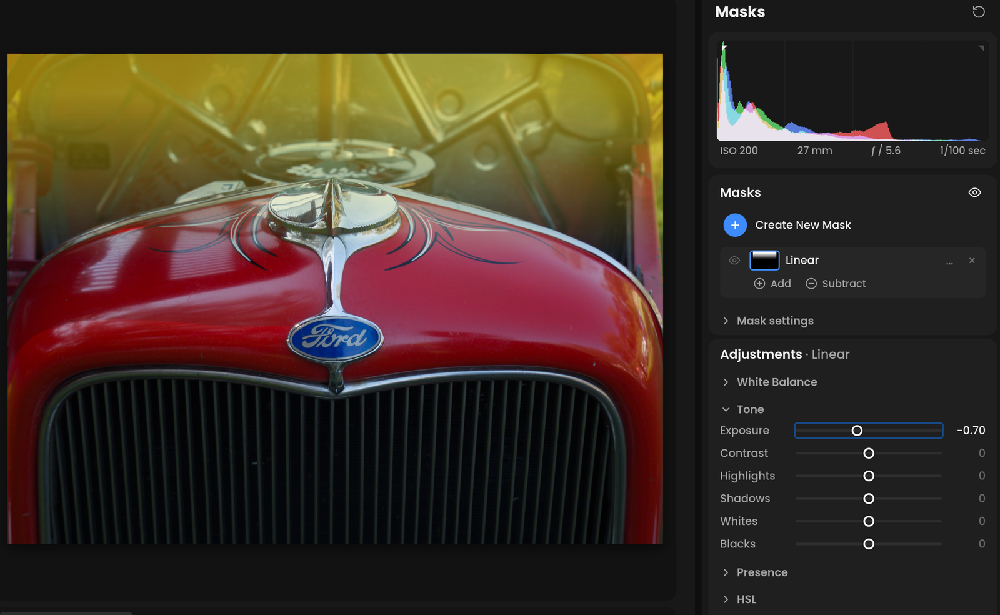

# Masks

Masks let you adjust one part of the photo: brighten a face, darken the
sky, warm the foreground. Each mask has its own set of sliders.

**If you've used another editor:** this is the usual masking panel. It
has the usual tools (AI Subject, Sky, Background, People, Select Object, brush,
linear and radial gradients, color, luminance and depth ranges) and the
same keys: K brush, M linear, ⇧M radial, ⇧J color range, ⇧Q luminance
range, O overlay.

Open it with **Masks** on the rail, or press one of the tool keys.


<!-- screenshot: Masks mode, a mask selected, overlay on, local sliders visible -->

## Creating a mask

Click **Create New Mask** and choose:

| Group | Tools |
| --- | --- |
| AI | **Subject**, **Sky**, **Background**, **People**, **Landscape** ▸ (**Sky**, **Water**, **Vegetation**, **Mountains**, **Natural Ground**, **Architecture**, **Artificial Ground**), **Select Object** |
| Shapes | **Brush** (K), **Linear Gradient** (M), **Radial Gradient** (⇧M) |
| Ranges | **Color Range** (⇧J), **Luminance Range** (⇧Q), **Parametric**, **Depth Range** |

- **AI** tools find the area for you. The first time you use one, its
  model downloads ("first use only"), which takes a moment. **Select
  Object**: click the object, or drag a box around it. **Background** is
  the subject's outline, inverted.
- **Brush**: paint; hold ⌥ to erase.
- **Linear Gradient**: drag across the photo where the change should
  happen.
- **Radial Gradient**: drag out an ellipse, or click for a circle.
- **Color Range**, **Luminance Range** and **Depth Range**: click the photo
  on the color, brightness or distance to select.

A new mask is named after its kind, such as **Sky** or **Radial**. Make a
second of the same kind and they become **Radial 1** and **Radial 2**.

## Copying AI masks between photos

When **Masks** is ticked in **Copy Settings**, Paste and Previous settings
recalculate AI selections from each destination photo. Subject, Background,
People and landscape selections find the corresponding area again. Select
Object uses the same relative clicks or box, so the intended object should be
in a similar position. Depth Range recalculates the saved near/far band.

The mask's adjustments, inversion, opacity, visibility, refinement and
add/subtract parts are preserved. Manual brush, gradient and range parts keep
their copied settings. Fit to Background uses the destination's detected color.

The first use of a model may download it. Editing and navigation pause during
paste. If a selection finds nothing or AI fails, the whole paste is rolled
back; no source outline is substituted. Undo and redo restore the saved mask
results without running AI again.

Older AI masks lack the selection information needed for recalculation. Paste
explains which mask must be recreated once on the source photo before copying.
Older Depth Range masks already retain their range and can be recalculated.

## Shaping a mask

Select a mask, then use **+** to add to it or **−** to subtract from it,
with any of the same tools. Under **+**, the ranges are listed under
**Intersect**: they narrow the mask to a color, brightness or depth within
it. For example, add a Sky mask, then intersect a Luminance Range to keep
only its bright clouds.

Each part of the mask is listed under it, with a **+** / **−** switch and
**×** to delete it.

On the photo, drag a shape's handles: the center moves it, the edges size
it, the arrow rotates it, and the outer ring sets its feather. The
handles show while the pointer is over the photo, and step aside while it
is over the panels, so the adjustment can be seen.

## The mask list

- The selected mask opens to its shapes and its **Add** and **Subtract**
  buttons. The chevron at the start of a row folds them away or opens them
  again; on another mask it selects that mask open. Each mask keeps its fold.
- The eye shows or hides the mask's adjustments.
- Hover over a name for a moment to see that mask in red.
- Double-click a name to rename it.
- The **…** menu has **Duplicate Mask**, **Duplicate Mask Only**,
  **Duplicate and Invert Mask**, **Duplicate and Invert Mask Only**,
  **Reset Mask Adjustments**, **Rename Mask** and **Delete Mask**.
  The **Only** copies keep the mask's shapes, Invert, Opacity and Refine
  but start with no adjustments. **Reset Mask Adjustments** returns every
  adjustment of the mask to neutral and keeps the mask itself; it is
  unavailable while the mask has no adjustments.
- O, or the eye in the panel's title, shows or hides the red overlay.
  While you add to or subtract from a mask, its overlay shows even with
  the toggle off; O hides it until you put the tool down, and moving one
  of the mask's sliders hides it until your next stroke. A mask an AI
  selection has just made shows its overlay too, so you can see what was
  selected, until you press O or move one of its sliders.

## Mask settings

- **Invert**: adjust everything except the mask.
- **Opacity**: 0-100%, how strongly the mask's adjustments apply.
- **Refine**:
  - **Edge Aware**: softens the edge so it follows edges in the photo
  - **Blur**: softens the edge
  - **Detail**: keeps the mask to detailed areas, or flat ones (raws only)
  - **Contrast**: hardens or softens the mask's falloff
- A part's own settings: **Feather** for brushes, radial gradients and
  objects; **Near**, **Far** and **Feather** for depth; **Low (EV)**,
  **High (EV)** and **Smoothness** for luminance; **Hue**, **Hue Range**, **Minimum Chroma** and **Smoothness** for color.

## The brush

**Size** (0.5-40% of the photo), **Feather** (0-100), **Density** (1-100)
and **Erase (hold ⌥)**. Drag to paint a stroke, or click once to paint a
single dab, such as over an eye.

| Key | Action |
| --- | --- |
| [ and ] | brush size |
| Scroll | brush size; ⇧-scroll its feather |
| ⌥-drag | erase |
| Esc | put the brush down |

## Parametric

**Parametric** selects by darktable's blending channels: gray, red, green,
blue, and lightness, chroma and hue (Jz, Cz, hz). Each channel has a slider
with four markers that set the range and its soft edges, and a **+** / **−**
switch for inside or outside it. Drag a box on the photo to set a channel
from it. **Boost** raises the range for bright highlights, and **Invert
Polarities** flips every channel. Double-click a channel to reset it.

## Adjusting inside a mask

The selected mask's sliders sit below its settings, in six groups:

- **White Balance**: **Temp**, **Tint**
- **Tone**: **Exposure** (±4), **Contrast**, **Highlights**, **Shadows**,
  **Whites**, **Blacks**
- **Presence**: **Texture**, **Clarity**, **Dehaze**, **Hue**,
  **Saturation**; with **Detail loupe** on in Preferences, the 100% loupe
  sits at the top, sharing the main panel's area and point picker
- **HSL**: **Hue**, **Saturation** and **Luminance** tabs, each with the
  eight color bands
- **Color Grading**: **3-Way**, **Global** or **Sliders**, for shadows,
  midtones, highlights and global
- **Detail**: **Sharpening**, **Noise**, **Defringe**

They work like the same sliders in [Adjustments](adjustments.md), only
inside the mask. A new mask opens its **Tone** group.

Choose mask modules independently of global adjustments under
[Preferences › Modules › Masks](preferences.md#modules). Alternatives are
available for Contrast, Highlights and Shadows, Clarity, Texture and
Sharpening. A mask's Defringe always uses chromatic aberrations. Used mask adjustments keep their modules when preferences change;
new masks and unused tools take the current mask choices.
**Whites** is the exception: the photo's Whites moves the top of the tone
mapper's curve, which can't run inside a mask, so a mask's Whites only
brightens or darkens its brightest tones, as the photo's Whites also does
under AgX.

Where masks overlap, their adjustments add up. **Contrast**,
**Saturation**, **Whites**, **Color Grading**, **HSL**, **Texture**,
**Noise** and **Defringe** add up only to the end of their own slider, so two masks at +80 Contrast give
+100 where they meet.

## Keys

| Key | Action |
| --- | --- |
| K | Brush |
| M | Linear gradient |
| ⇧M | Radial gradient |
| ⇧J | Color range |
| ⇧Q | Luminance range |
| [ ] | Brush size |
| O | Show or hide the overlay |
| Esc | Put the tool down |

Clarity and Texture use **contrast & texture** by default, or local contrast
and diffuse or sharpen, chosen independently in
[Preferences › Modules](preferences.md#modules). Medium and Fine details stay
visible; the sliders icon in the panel's title row shows the remaining native
controls. Contrast equalizer
can also replace mask Contrast: select **Custom**, then **Masks › Contrast ›
contrast equalizer**. The mask's Tone group shows the same five-channel,
six-band graph described in [Adjustments](adjustments.md#contrast-equalizer),
applied only inside that mask. Global Contrast can still use AgX. Masked
equalizer instances run separately; the slider-based overlap limits described
above apply to color balance rgb Contrast. Likewise **Masks › Saturation ›
saturation curve** replaces the mask's Saturation slider, in its Presence
group, with the [saturation curve](adjustments.md#saturation-curve), on an
instance of its own per mask. A mask in black and white hides it, as it hides
Saturation.

Object selections use the same model folder as the other AI tools. A model
downloaded during the current session is available immediately; restarting the
app is unnecessary. Existing valid models are reused.

Each download is checked against the exact model file this version of Immage
expects. If the file on the download server has changed, the model is not
installed and the message says an update of Immage is needed; updating Immage
fixes it.

## Reporting an AI model loading error on Linux

If an AI tool repeatedly downloads its model and then says it cannot load it,
use the diagnostic script to capture the native loading error. Subject and
Select Object use different models, so one can work while another fails.

1. Close Immage. Copy `app/scripts/diagnose_ai_appimage.sh` from the source
   repository to the affected machine, beside your AppImage.
2. In a terminal in that folder, run:

   ```sh
   sh diagnose_ai_appimage.sh ./Immage.AppImage
   ```

   Replace the AppImage filename with yours.
3. Try one Object mask, wait for the error, then close Immage. Avoid in-app
   Relaunch during this diagnostic run.
4. Share the `immage-ai-report.*.tar.gz` file created in that folder.

The report contains AI and launcher logs, platform information and Object model
file sizes, checksums and configuration. It contains no photos or model weights.
Logs can include local file paths. The debug switch applies only to this launch;
the script does not change saved preferences or delete model files. The app's
normal automatic model recovery can still download the model during the test.

## Adjusting a color range

After picking a color, select its component in the mask to adjust **Hue**
(the center color), **Hue Range** (how many neighboring hues are included),
and **Smoothness** (the soft transition at the edges). Increase Hue Range
to expand the selection or lower it to narrow it. Hue wraps around the
color circle. Very broad ranges limit their effective soft edge to fit.

**Minimum Chroma** excludes nearly neutral pixels: lower it to include less
colorful areas, or raise it to restrict the mask to stronger colors. Its
scale represents scene chroma multiplied by 1000.

The selected mask overlay appears automatically while adjusting these controls,
including keyboard and numeric edits, and stays briefly afterward while the
preview catches up. Your normal overlay setting is preserved.
