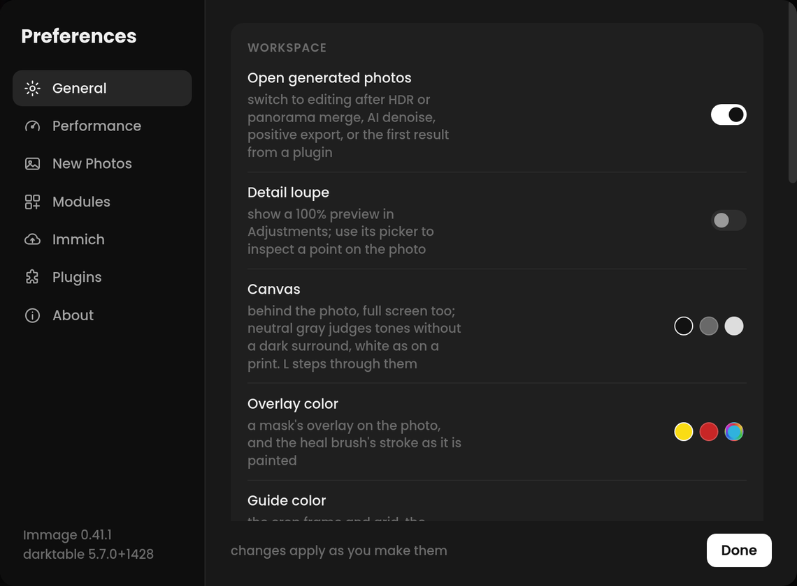

# Preferences

Open **Preferences** with ⌘, or the gear at the bottom of the rail. Changes
apply as you make them; **Done** closes the window.


<!-- screenshot: Preferences > General -->

## General

**Workspace**

- **Detail loupe**: optional compact 100% previews above Detail and Presence,
  in Adjustments and in a mask's Presence group, off by default. Both show the same area. Use the point picker, then click
  the photo to choose it; Escape cancels. Turning it off stops loupe rendering.
- **Open generated photos**: automatically opens HDR merges, panoramas, AI
  denoise results, positive exports and the first plugin result for editing.
- **Generated positive format**: losslessly compressed DNG (16-bit float,
  default) or TIFF (32-bit float) for **Export to Library** in the Negative
  and Film Simulation panels. The DNG and TIFF buttons beside that button set
  the same thing.

- **Canvas**: what is behind the photo, in full screen preview too.
  **Dark**, **Neutral Gray** to judge tones without a dark surround, or
  **White** to see the photo as on a print. L steps through them.
- **Overlay color**: the color a mask's overlay and the heal brush's stroke
  are drawn in over the photo: **Yellow**, **Red** or a color of your own.
- **Overlay opacity**: how solid the overlay is where a mask is fully
  selected, from 10% to 100% (55% by default); a feathered edge fades out
  from there. **Reset** restores the default.
- **Guide color**: the color of the lines drawn over the photo: the crop
  frame and its grid, the straighten line, Transform's grid and guides,
  the vignette's guides and a mask shape's outline. **White**, **Yellow**,
  **Red** or a color of your own. Each line has a thin dark edge, so even
  white shows on a light photo or a White canvas.
- **Focus mode**: opening a panel closes the others; ⌥-click opens one
  alongside. On by default.
- **Auto-hide panels**: the side panels and filmstrip slide away when the
  pointer leaves them, and back at their edge: the rail, or the window's
  bottom edge below the toolbar. A pin keeps one open.
- **Scroll adjusts sliders**: off by default, so scrolling over the panels
  only scrolls them and an edit can't change by accident.

**Library**

- **Stack RAW+JPEG pairs as one photo**: a raw and the JPEG, HEIF or OM
  System .ORI of the same name show as one, and a rating, reject or delete
  takes them all.

**Startup**

- **Quick start guide**: the short tour when Immage opens.

## Performance

How fast the photo responds while you edit, and the memory and disk
Immage keeps to make it so.

**Interface rendering** (Linux)

Official Linux AppImages bundle WebKitGTK and JavaScriptCore 2.54.2 and
keep the Ubuntu 22.04 runtime baseline, including Linux Mint 22.x. The bundled
webview retains video and audio support; MPEG-TS and WebRTC are not enabled. GUI benchmark
reports record the running WebKitGTK version; use a new build when comparing
renderer behavior after upgrading. On Wayland, **Drag drafts at the screen’s
scale** still sizes reduced drag previews for the compositor’s actual fractional
scale (for example, 125%), while release frames keep full quality. GTK 3
still draws the window and full-quality release frames at the next integer
scale (200% at 125% or 150%), which can increase rendering and presentation
time. Using 100% scaling or `GDK_BACKEND=x11` can reduce this overhead;
performance depends on the system.

Starting with 0.41.1, normal AppImage launch handles the resolved NVIDIA/X11
startup issue automatically: the launcher chooses the WebKitGTK installed by
your distribution when it detects X11 and a loaded NVIDIA driver. Wayland, other GPUs and uncertain
backend selections use WebKitGTK 2.54.2 included in the AppImage. The system
version depends on your installed packages; the launcher does not require or
select a particular older release such as 2.52. The host must provide compatible WebKitGTK,
JavaScriptCore, GTK dependencies and matching helper processes; automatic mode
falls back to the bundle if its startup checks fail. On the NVIDIA/X11 system
path, the launcher also disables WebKit's GBM rendering path by default. Manual
testing confirmed the updated automatic launcher works on the reported
Mint/X11/NVIDIA and Ubuntu/Wayland systems. The earlier Mint test also confirmed
fast launch with NVIDIA selected when GBM was disabled. Results on other
hardware may vary.
Replace `Immage.AppImage` below with your downloaded filename. Close Immage
between comparisons and keep the same photo and window-renderer preference.

**Mint / X11 / NVIDIA:** normal launch selects your installed WebKitGTK and disables GBM
when the host stack passes compatibility checks:

```bash
./Immage.AppImage
```

To force the combination confirmed to launch quickly on the affected Mint system:

```bash
IMMAGE_WEBKIT=system GDK_BACKEND=x11 WEBKIT_DMABUF_RENDERER_DISABLE_GBM=1 ./Immage.AppImage
```

**Ubuntu / Wayland:** normal launch uses bundled WebKitGTK 2.54.2. To force that path:

```bash
IMMAGE_WEBKIT=bundled GDK_BACKEND=wayland ./Immage.AppImage
```

These rules follow the session and driver, rather than the distribution name.
For example, Ubuntu on X11 with NVIDIA follows the same rule as Mint/X11.

To compare either runtime without forcing a display backend:

```bash
IMMAGE_WEBKIT=system ./Immage.AppImage
IMMAGE_WEBKIT=bundled ./Immage.AppImage
```

The default is `IMMAGE_WEBKIT=auto`. Forced `system` mode stops with a message
if the host stack is unavailable or incompatible, rather than silently using
the bundle. The launcher prints its selected runtime and detected backend to
stderr. `GDK_BACKEND=x11` or `GDK_BACKEND=wayland` explicitly selects the backend;
backend lists keep the bundle in automatic mode. These switches select the UI
runtime, independently of the window renderer and photo-processing settings.
An NVIDIA driver detected on a hybrid system also qualifies for the experiment.

You can explicitly enable or disable WebKit's GBM path for comparison:

```bash
WEBKIT_DMABUF_RENDERER_DISABLE_GBM=0 ./Immage.AppImage  # enable GBM
WEBKIT_DMABUF_RENDERER_DISABLE_GBM=1 ./Immage.AppImage  # disable GBM
```

An explicit value takes precedence over the launcher's default. Leaving the
variable unset restores automatic behavior. Wayland, bundled mode, automatic
fallback to the bundle and other GPUs receive no GBM default from the launcher.
System mode prints `GBM-disable=1`, `0` or `unset` alongside its runtime selection.

For the published 0.41.0 release or forced bundled mode, X11 desktops with
NVIDIA can still have launch or rendering issues. If Immage fails to launch, run:

```bash
GDK_BACKEND=x11 WEBKIT_DISABLE_DMABUF_RENDERER=1 ./Immage.AppImage
```

Replace the filename with your downloaded AppImage. Select **Mesa** under
**Preferences → Performance** and restart Immage. Once Mesa is selected,
normal launches no longer require these environment variables, as confirmed
on the reported Mint/X11 system. Ubuntu/Wayland testing showed improved NVIDIA
performance; results still vary by system.

- **Window renderer**: **Automatic** uses the system default renderer, including on NVIDIA;
  **Mesa** selects Mesa's EGL explicitly, and **NVIDIA** selects NVIDIA's.
  Only installed drivers can be selected. On NVIDIA, Mesa normally draws
  the interface on the CPU. This setting is separate from **Edit on the
  GPU**, which controls darktable's photo processing.
- The row shows the active EGL selection. **Relaunch** saves the photo and
  restarts Immage to apply a change. An explicit
  `__EGL_VENDOR_LIBRARY_FILENAMES` in the launch environment takes priority.
- For an A/B benchmark, select Mesa, relaunch, open the test photo and run
  the GUI benchmark. Repeat with NVIDIA on the same build, photo, window
  size and editing settings. The reports record the selected path,
  environment, WebKitGTK version and WebGL renderer.

**Editing**

- **Preview**: how much the photo gives up for speed while you edit.
  Export is never affected.
  - **Quality** renders every frame in full, even while you drag.
  - **Balanced**, the default, renders at half size while a slider, wheel
    or curve moves, about four times as fast, and in full on release.
    **Balanced preview size** offers 50% (the default), 75%, and 100%. At 100%,
    drag previews stay full size and automatic smaller drafts are disabled.
    Grain, Texture and Sharpening are left out until release, unless they
    are what you are dragging. They are also left out of the zoomed-out
    picture behind the photo, which the navigator and histogram read and
    you see at the edges while zooming and panning.
  - **Performance** drags at quarter size, also without noise reduction and
    HSL, and renders the picture behind the photo only at the viewer's
    size, so zooming in shows it softer until the sharp view arrives.
- **Shared-memory frames** (Windows and Linux): hands each frame to the
  window in memory both share, rather than copying it. On by default; turn
  it off only to compare the two in the GUI benchmark.
- **Drag drafts at the screen's scale** (Linux Wayland): appears when the
  detected screen scale is below the webview's pixel ratio, such as 125% on
  a window drawn at 200%. On by default, it reduces drag-preview pixels to
  match the screen, including full-size drag previews (100% Balanced, and
  the whole-view preview of Texture, Clarity, Luminance NR and Grain; Quality
  keeps every pixel). Settled frames still use the full webview resolution.
  Turn it off to compare GUI benchmarks with the same photo, window size and
  preview settings. This does not change GTK's window-surface resolution.
  Benchmarks in a virtual machine give approximate comparisons within that
  setup; they do not predict native GPU performance.
- **Fit frames at the screen's scale** (same condition): on by default.
  Renders the settled Fit frame for the screen's scale and lets the page
  enlarge it, which cuts pixels; turn it off if the photo looks soft. Zoomed
  and 1:1 frames are unaffected. It takes effect on the next frame.

**Memory**

- **darktable memory**: how much of this computer's memory darktable may
  take for its pipes and caches. **Small** keeps to about an eighth, for
  working beside other large programs, though more of each edit is then
  worked out again; **Default** about half; **Large** about two thirds,
  for when Immage is the only large program running. It applies once
  Immage starts again: **Relaunch** saves the photo and restarts.
- **Frame cache**: memory for the views of the photo already shown, so
  zooming back out or going back to a view seen before shows it at once,
  without a render. A view at 100% is about 30 MB on a 4K screen and 45 MB
  on a 5K one. 512 MB on a 4K screen or larger, 256 MB on a smaller one.
- **Thumbnail memory**: for the library's thumbnails. Past it, those
  scrolled out of sight longest are let go and read from the disk cache
  again when you scroll back. A thumbnail takes about 1 MB, so the
  default, 1 GB, holds some 900.
- **Read ahead**: how many photos have their raws decoded while you edit,
  in the direction you last stepped, so the arrow keys open them without
  waiting for the decode. Up to three are decoded at once. Each holds its
  raw in memory, about 50 MB for a 24-megapixel photo. One by default.
- **Read ahead both ways**: as many photos behind the open one too, for
  stepping back. Off by default.

**Cache**

How much disk each cache may take, with what it holds now. **Clear**
empties one.

- **Library thumbnails**: so a folder seen before opens at once. 1 GB by
  default.
- **Immich thumbnails**: search results scrolled through. 512 MB by
  default.
- **Immich originals**: photos opened from Immich. One you have edited is
  kept whatever the limit, as its edit is beside it. 10 GB by default.

The thumbnail caches keep nothing while the disk has under 5 GB free.

**AI Acceleration**

- **GPU**: what AI upscaling at export runs on. **Automatic** picks the
  first one found. If none is found, AI upscaling isn't offered.
- **Device**: which graphics card, when there is more than one.

**Measuring**

- **Performance overlay**: shows, over the photo, the frame rate, the time
  from a slider moving to the photo changing, where that time went, and
  every darktable module instance in the last frame with its time. Its
  Session tab keeps the slowest response so far and each module
  instance's runs, last, average, slowest and total times, until Reset or
  quitting. × or ⇧⌘P closes it.
- **GUI benchmark**: **Run** drags the main sliders on the open photo and
  back, zooms in and out, and saves a timing report. Every slider ends where
  it started, but use a copy of a photo you care about.
  Resource readings are sampled: brief CPU spikes or short-lived helper
  processes can be missed. Compare reports made with the same build and
  measurement settings when assessing a settings change. When comparing app
  versions, repeat runs with the same photo, viewport and preview settings;
  compare completed frames and input latency, since time spent in individual
  processing stages can move between versions.
- **GPU check**: **Run** renders the open photo with darktable on the CPU
  and on the GPU (OpenCL), compares the two, then repeats with each of
  several modules turned on in turn: Exposure, both Shadows and Highlights
  modules, both Texture and both Clarity modules, Dehaze, luminance noise
  reduction, the lens profile, Sharpening, Vignette, Grain, Vibrance and
  White Balance. Last, it starts a GPU render, cancels it with an Exposure
  drag and compares the photo once more. The status bar shows how many cases
  passed and where the report was saved: a `gpu-<time>.json` file in the app
  data folder's `benchmarks` folder, beside the GUI benchmark's reports,
  with a `.png` of the difference for any case that failed. Send the report
  back to help test GPUs. A case passes when the GPU rendered it without
  falling back to the CPU, and 99% of its pixels are within ΔE 2 of the
  CPU's. A module darktable runs on the CPU anyway is noted, not failed.
  Cases the photo cannot show (a raw-only control on a JPEG) are skipped.
  Every control ends where it started, but the cases go into the photo's
  history, so use a copy. Without an OpenCL device the report still saves,
  saying none was found. The report names the computer and the photo's file.

Use the **Performance tuner** with a representative RAW and your usual window
size. Set FPS and latency targets, run it, review the recommendation, then
apply it and verify with another run. Export quality is unaffected.

The performance tuner defaults to an 80 ms latency target. It uses the median
of the middle 10–90% of measured frame intervals and input-to-paint latencies,
then tries Balanced 100%, followed by smaller preview sizes and drafts only
if the targets are missed. The first configuration
meeting both targets is recommended. Full Quality remains a manual option and
is excluded from the tuner search.

## New Photos

What a photo starts with the first time it is opened, if it has no history
yet in Immage or darktable. A photo darktable has opened already keeps its
own settings, even if nothing was changed there. These settings are the
photo's starting point: they don't mark it as edited.

- **Profile**: the color look a raw starts with: one of AgX's looks
  (**AgX Default**, the default) or one of color balance rgb's
  (**Standard**, **Natural Skin**, **Vibrant Colors**, **Legacy**). JPEGs
  keep the camera's look.
- **Exposure compensation** and **Amount**: brightens or darkens every new
  raw by an amount in EV, for a camera whose raws come out too dark or too
  light; +1 is common. Exposure in Basic still starts at 0 and adds to it,
  so Exposure +0.5 makes +1.5 in all, and **Auto** allows for it. The
  photo keeps the amount it started with: changing the setting later
  leaves photos already opened alone. It isn't an adjustment, so **Reset
  all**, the Before view, Copy Settings and presets leave it as it is; to
  take it off one photo, reset or delete the **exposure • compensation**
  row in History once the photo has been opened again. JPEGs get none.
  Off by default; the amount starts at +1.
- **Apply Auto** (Auto Tone): runs Basic's **Auto** once a raw has
  rendered. Off by default.
- **Apply preset**: **Default** gives a raw lens corrections; JPEGs get
  nothing. Or **None**, or any preset.
- **Save current settings…**: makes a preset from the open photo, with only
  the settings you tick.
- **Keywords for edited photos**: keywords a photo gets once you edit it,
  `immage` for instance. They go into the photo's sidecar, where Immich
  reads them, so its Tags filter finds what you edited in Immage. A photo
  reset or undone back to unedited loses them again, even if you had also
  added them yourself. Unlike the settings above, they apply to photos
  edited in darktable too, once you change something in Immage. None by
  default.
- **Copyright** and **Creator**: filled in once you edit a photo, like the
  keywords, but only where the photo has none yet. A copyright or artist
  the camera recorded, or one you typed in the Metadata panel, stays.
  `{year}` becomes the year the photo was taken, so `© {year} Your Name`
  reads `© 2026 Your Name`. Resetting the photo keeps them. Empty by
  default.

## Modules

Which darktable module each tool runs on. **Default** uses the module of
darktable's AgX workflow for each, except Clarity and Texture, which use
contrast & texture; **Custom** lets you pick one per tool,
under separate collapsible **Global** and **Masks** sections. For example,
use AgX for global Contrast and contrast equalizer for masks. With **Focus mode**
on, opening one section closes the other; Alt-click keeps both open. With it off,
sections open independently, and Alt-click opens one on its own. Global offers:

- **Contrast**: AgX (or sigmoid on a photo started under it), color balance
  rgb, or contrast equalizer, which replaces the slider with a curve editor
- **Blacks**: AgX (or sigmoid), or exposure
- **Saturation**: AgX (or sigmoid), color balance rgb, or saturation curve,
  which replaces the slider with saturation and brilliance curves
- **Clarity**: contrast & texture, or local contrast
- **Texture**: contrast & texture, or diffuse or sharpen
- **Highlights and Shadows**: the tone equalizer, or shadows and
  highlights
- **Black & White**: color calibration, or the color equalizer
- **Sharpening**: sharpen, or diffuse or sharpen

**Masks** independently offers Contrast (color balance rgb or contrast equalizer),
Highlights and Shadows, Saturation (color balance rgb or saturation curve),
Clarity, Texture and Sharpening. Modules without
alternatives are also listed. The same choice is available from the icon
beside each tool's name in the panels; its **Set as default** writes the
choice here (see [darktable modules](darktable.md)). Existing mask adjustments keep their modules;
unused tools and new masks take these choices.

Clarity and Texture use **contrast & texture** by default, in place of a
single slider: the module's Coarse, Medium and Fine details, Base detail
level, Halo control, Noise bias, Shadows and Highlights sliders, using
darktable's ranges and defaults. Medium and Fine details stay visible; expand
**Advanced** for the other controls. This also applies to masks. Clarity and
Texture use separate instances. It runs on the GPU with OpenCL, and faster
than diffuse or sharpen. Under Custom, choose local contrast for Clarity or
diffuse or sharpen for Texture to get the single slider back.

The tab also lists the module behind each of the other tools. A photo that
already uses one of a tool's modules keeps it, so its edit looks the same;
closing Preferences applies the choice to unused tools on the current photo
as well as photos opened later. **Reset all** puts every tool back on the
module chosen here. See [Adjustments](adjustments.md#contrast-equalizer)
for the equalizer graph. Defringe, global and in masks, always uses
chromatic aberrations: darktable deprecates its older defringe module.

## Immich

The server, API key, duplicate checking and path map. See
[Immich](immich.md) for setting it up step by step.

## Plugins

Applications a photo can be sent to with right-click › **Edit In**. See
[Edit In](edit-in.md).

## About

Versions, the license, and where the source is. Immage's version comes
with the commit it was built from, ten digits, with `-dirty` for a build
from a tree with uncommitted changes; the same commit shows under the
versions at the bottom of every tab, and in GUI benchmark, GPU check and
tuner reports. Below the versions, three icons open Immage's homepage
(immage.photo), its Discord server and its GitHub page in your browser.
Under **Updates**:

- **Check automatically**: once a day, Immage asks its releases on GitHub
  whether a newer version is out, and sends nothing else. On by default.
- **Check Now**: asks at once, and says what it found.

A newer version shows as a card in the bottom-left corner, with its
release notes. **Install and Relaunch** downloads it, saves the photo you
are editing, and opens the new version where you were. **Later** puts the
card away until Immage next starts; **Skip This Version** waits for the
one after. Updates are signed, and one whose signature does not match is
not installed.

Loupe rendering pauses while selecting or browsing photos in grid view and
refreshes when you return to the photo view.

### Native Linux diagnostic benchmark

Diagnostic builds include shared-frame write, reply and WebKit read durations in
GUI benchmark reports, plus engine allocation, pixel conversion, file output and
cleanup timings. These measurements help locate preview latency; they do
not change preview resolution or measure compositor presentation. On the native
machine, close the installed Immage, launch the diagnostic AppImage, open the
same copied photo and use **Preferences > Performance > Measuring > GUI benchmark**.
Keep the window size, Balanced preview size and other performance settings the
same. Collect one report at 100% and one at 125%, recording display scale and
refresh rate. Keep the app visible and do not resize it during either run.
Return both JSON reports from the benchmarks directory shown after completion.
The existing 0.41.1 reports remain the baseline; no further baseline run is needed.

### Mac CPU profiling alongside a benchmark

To investigate a busy CPU core, run the repository’s
[Mac CPU capture script](../../benchmarking/MACOS_PROFILING.md), wait for Time
Profiler to start recording, then run **Performance > Measuring > GUI benchmark**.
Save the benchmark JSON with the capture. Full Xcode is required. System-wide
capture includes other applications; the guide explains scope and sharing. Keep
the photo, window and performance settings fixed throughout the run.

Ctrl-C stops a Mac CPU recording early; allow the profiler to finish saving and
the script to export before closing the terminal.

## Dropdown menus

Every dropdown in Immage opens in the same dark menu as the right-click menus, on every system. Click it, or focus it and press Space or Alt+Down. Arrow keys, Home and End move, Enter chooses and Escape closes. The current choice has a check mark.
