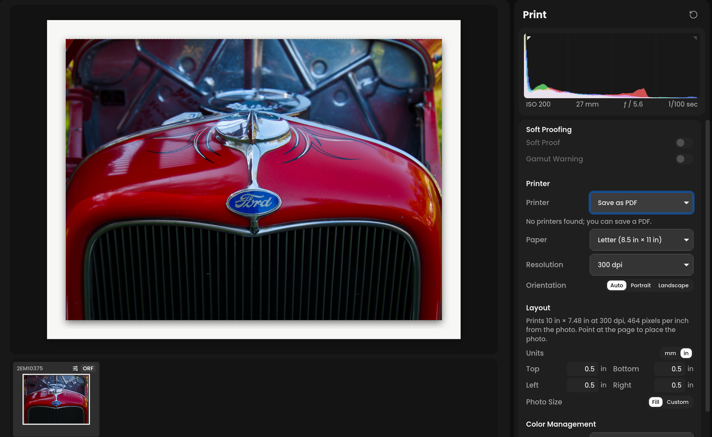

# Print and soft proofing

The Print panel prints the open photo, or saves it as a PDF. It can convert
the colors with your printer's ICC profile, and soft proof the photo on
screen with that profile first, so you see the print before you make it.

**If you've used another editor:** it is the Print module's single-photo
layout plus the soft proofing view, put together in one panel. Soft
proofing uses darktable's soft proof, and printing uses darktable's print
code.

Open it with **Print** on the rail, the last button under Export, or ⌘P.
The panel's settings stay the same from photo to photo, and between runs.

<!-- screenshot: Print panel with a printer and a printer profile chosen, Soft Proof on, the viewer showing a landscape photo on a Letter page with its margins dashed, the "Soft Proof:" label over the photo -->

## Soft proofing

Soft proofing shows the photo as the printer and paper can print it.
Colors the paper can't reach are brought in, the way the print will bring
them in. A colorful photo often looks a little duller.

- **Soft Proof** turns it on. It proofs against the profile chosen under
  **Color Management**, with that profile's **Intent**, so choose a profile
  first. S turns it on or off from anywhere.
- **Gamut Warning** paints the colors the profile can't reach cyan, so you
  can see which ones will change.

While the proof is on, the top right of the photo says **Soft Proof** with
the profile's name. The proof stays on when you go back to Adjustments or
another panel, so you can edit the proofed photo: raise Saturation or
change a color in HSL until the proof looks right. The edit is the same
edit. The proof changes only what the screen shows, and never what exports
or prints. Turn it off with S or the switch.

The proof uses relative colorimetric with black point compensation for
the step from the profile to your screen. It does not show the paper's own
white or the ink's black.

## Printer

- **Printer**: the printers your computer knows, or **Save as PDF**. The
  first time, Immage picks your default printer.
- **Paper**: the sizes the printer offers. A PDF offers the common sizes:
  Letter, Legal, Tabloid, 8 x 10, 5 x 7, 4 x 6, 13 x 19, A5, A4, A3 and
  A3+.
- **Media Type**: the paper types the printer's driver lists, when it lists
  any. **Printer default** leaves it to the driver.
- **Resolution** (PDF only): 240, 300, 360 or 600 dpi. A printer prints at
  its own resolution, which the panel shows.
- **Orientation**: **Auto** turns the page to suit the photo: landscape for
  a wide photo, portrait for a tall one. **Portrait** and **Landscape** fix
  it.

## Layout

One photo goes on each page. While the panel is open, the viewer shows the
page in place of the photo: the paper to scale, the margins dashed, and the
photo rendered in its place on it, soft proof included. The page fills the
viewer, so the photo can't be zoomed or compared with another while it is
shown; Before/After and Compare turn off when you open the panel. Other
panels show the photo on its own again. Under **Layout**, the panel says how
big the photo prints, and how many of the photo's pixels go in each inch.
Below 180 pixels per inch it warns that the photo is enlarged and may
print soft.

- **Units**: millimeters or inches, for the sizes shown and typed.
- **Top**, **Bottom**, **Left** and **Right**: the margins. A margin
  smaller than the printer can reach makes the print borderless, if the
  printer can print that way; the panel says so.
- **Photo Size**: **Fill** makes the photo as large as the margins allow.
  **Custom** sets its **Long Edge**, and the other edge follows the photo's
  shape. The photo never prints larger than the margins allow.
- **Place**: point at the viewer to see nine dots on the page, and click one to
  put the photo at the top left, the middle, the bottom right, and so on,
  inside the margins. The black dot is the place chosen now. The dots hide
  again when the pointer leaves the viewer.

The photo prints as it is cropped. Its edit is printed as it is now,
including edits you haven't stopped making.

## Color management

- **Profile**: **Managed by printer** gives the driver the photo in sRGB
  and lets it convert the colors. A printer profile makes Immage convert the
  colors instead, for that printer, ink and paper, in 16 bits per channel.
  Choose the profile made for the paper you print on.
- **Add Profile…** adds a profile file from your disk. Immage keeps its
  own copy, so the original can move.
- **Intent**: **Perceptual** brings every color in a little, keeping how
  colors relate to each other. **Relative** keeps the colors the paper can
  print exactly and moves only the ones it can't. Soft proof both to
  compare them.
- **Black Point Compensation**: maps the photo's black to the darkest
  black the paper prints, so the shadows keep their detail. Usually on.

The profile list shows printer profiles from the usual places on your
computer, as printer drivers install them, along with the ones you added:

- macOS: `~/Library/ColorSync/Profiles`, `/Library/ColorSync/Profiles` and
  the printer drivers in `/Library/Printers`
- Windows: `C:\Windows\System32\spool\drivers\color`
- Linux: `/usr/share/color/icc`, `~/.local/share/icc` and `~/.color/icc`

Only RGB profiles can be used. Printer drivers take RGB, so profiles made
for desktop printers are RGB.

When Immage manages the colors, turn color management off in the printer's
own settings, or the colors are converted twice. On Linux and macOS, Immage
asks the print system to leave the colors alone.

## Printing

**Print** renders the photo at the printer's resolution and sends it to
the printer. **Save PDF…** asks where to save the PDF. The PDF holds the
photo at the chosen resolution, tagged with its color profile: the printer
profile, or sRGB when the printer manages color. The panel says when the
job is sent or the file is saved, or what went wrong. You can keep editing
while it renders.

On Windows, the job goes to the printer with its default driver settings
plus the paper and orientation you chose.
