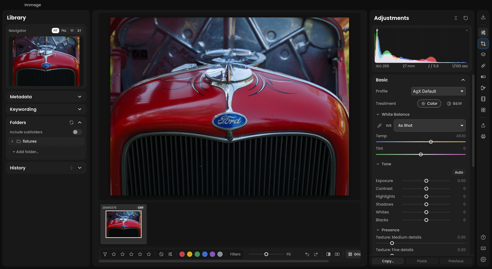
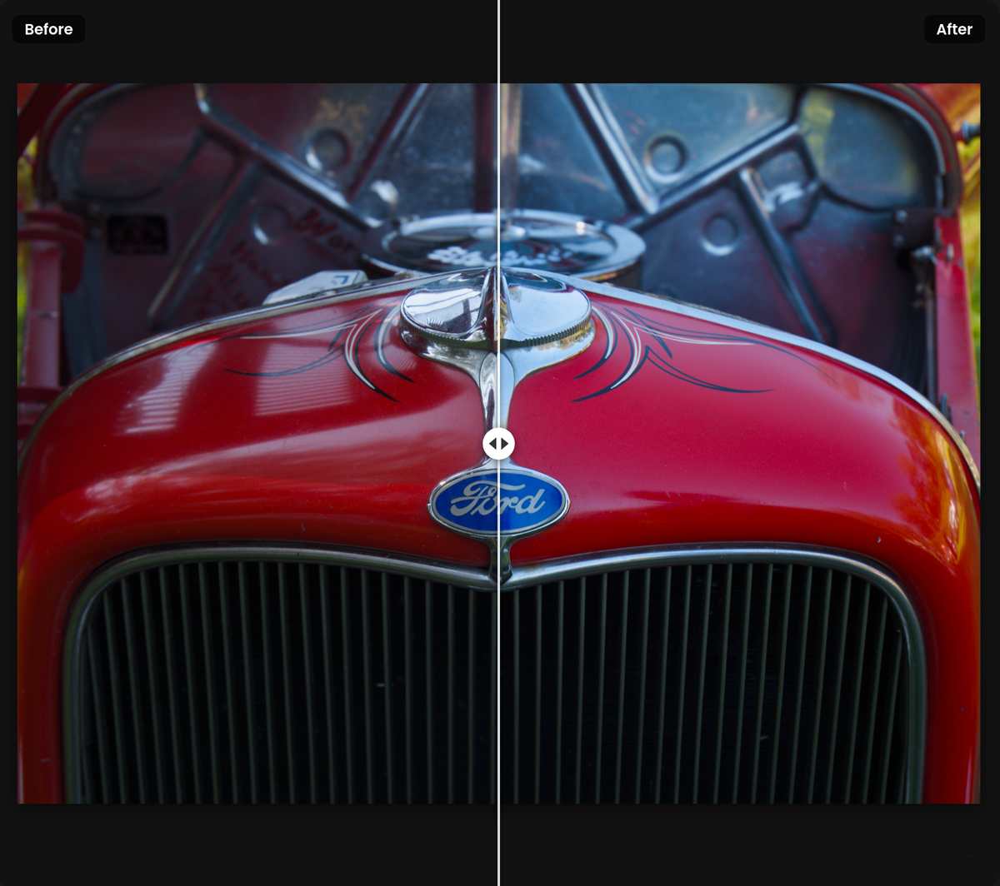
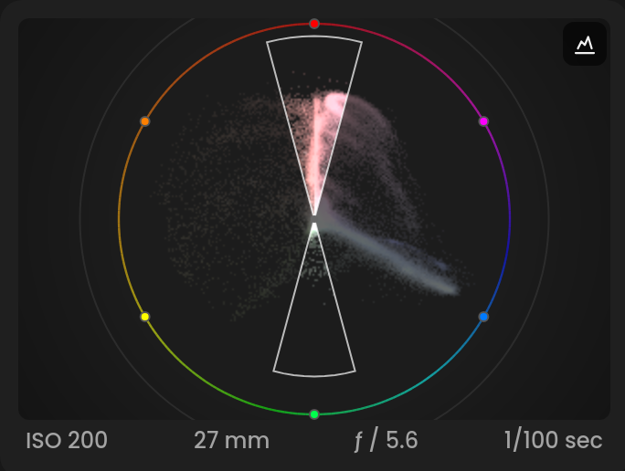

# The workspace

Immage keeps everything in one window: the **Library** panel on the left,
the photo in the middle, the filmstrip below it, the editing panel on the
right, and the rail down the right edge.

**If you've used another editor:** there are no separate library and
develop modes. The filmstrip and grid browse a folder, and the right side
always edits the open photo. The rail stands in for a module picker.

## The rail

The narrow column on the far right lists the work in order: bring photos
in, edit them, send them out.

| Button | What it opens |
| --- | --- |
| **Import** | the importer (⇧⌘I). See [Import](import.md). |
| **Adjustments** | the develop panels. See [Adjustments](adjustments.md). |
| **Crop** | the crop tool (R); a second click applies it. See [Crop](crop.md). |
| **Masks** | local adjustments. See [Masks](masks.md). |
| **Heal** | heal and clone (Q). See [Heal and clone](heal.md). |
| **Zone System** | black and white tones as zones. See [Zone System](zone-system.md). |
| **Film Simulation** | the photo rendered as a film, printed or scanned. See [Film Simulation](film-simulation.md). |
| **Negative** | a photo of a film negative turned positive. See [Film negatives](negative.md). |
| **Presets** | presets and film looks. See [Presets and looks](presets-and-looks.md). |
| **Export** | the export dialog (⇧⌘E). See [Export](export.md). |
| **Print** | printing, saving a PDF and soft proofing (⌘P). See [Print and soft proofing](print.md). |
| **?** | the quick start guide |
| Keyboard | the keyboard shortcuts sheet (⌘/) |
| Gear | **Preferences** (⌘,) |

Clicking the button of the panel that is already showing slides the right
panel shut. Crop, Masks, Heal, Zone System, Film Simulation and Negative need
a photo open.

Each tool remembers how far you scrolled its panel, so going back to
Adjustments returns you to the same place. A tool opens at its top the
first time.

On Windows, icon buttons use the standard arrow cursor across the whole
button, including its icon. Hover highlights and tooltips identify the tool.

## The Library panel

Down the left side, under the **Navigator**:

- **Metadata**: title, caption, rating, label and the camera's settings
- **Keywording**: the photo's keywords
- **Folders**: the folders you have added, as a tree
- **Immich**: search your Immich server, once it is set up
- **History**: every step of the edit

Click a card's title to fold or unfold it. See [Library](library.md) and
[History, undo and copying settings](history-and-sync.md).

## Looking at the photo

**Zoom**

- Click the photo to zoom to 100% at that point; click again to fit.
- Scroll, or pinch, to zoom around the pointer, from fit up to 400%. The
  zoom pauses at 100% on the way.
- Z switches between fit and 100%.
- Quality and Balanced process settled Fit views at up to 3072 pixels on the
  long edge to preserve fine detail when displayed smaller. Performance uses
  viewer-sized previews. The screen-scale preference can reduce the processing
  size; use 100% to judge detail at native resolution.
- The **Navigator** has **FIT**, **FILL**, **1:1** and **2:1**. When you
  are zoomed in it shows the visible part as a rectangle; drag it to pan.
- The zoom slider in the toolbar below the filmstrip zooms from a quarter
  of fit to 400%. Double-click it for fit or 100%.
- Drag the photo to pan.
- Once a photo has opened, and again each time you stop editing, Immage
  renders it at 100% in the background, so the first zoom in shows it at
  once. Zoomed in, it renders the fitted view the same way, ready for
  zooming back out. Either waits until the base view is done and stops as
  soon as you change something. A photo above about 64 megapixels is left
  out of the 100% render.

**Full screen preview**: F shows the photo alone on the canvas color,
black for **Dark**. F or Esc comes back.

**Info over the photo**: I cycles between the file name and capture date,
the exposure and lens, and nothing.

## Before and after

- \ shows the photo as it was before your edits, with a **Before** badge.
  Press it again to come back.
- Y, or the before / after button in the toolbar, steps through
  **Side by side**, **Split left / right**, **Split top / bottom** and
  **Hold for before**, then off. In the split views, drag the divider.
  With **Hold for before**, press and hold on the photo.

"Before" means the photo at its starting point, still with its crop and
orientation.

<!-- screenshot: Split left / right on an edited landscape, divider in the middle -->

## Compare

C compares the open photo with another one, side by side. The left one is
the photo you are editing; the right one is the candidate: a photo you
have selected, or the next in the filmstrip. ← and → step the candidate,
or click one in the filmstrip. The ⇄ button on its label swaps which one
you edit. Esc leaves.

## Histogram and scopes

The histogram sits at the top of the right panel.

- Drag sideways on it to move a Basic slider: from left to right the
  regions are **Blacks**, **Shadows**, **Exposure**, **Highlights** and
  **Whites**. Double-click a region to reset it.
- The triangles in its top corners light up when shadows or highlights
  clip. Hover one to see the clipped areas on the photo; click to keep
  them showing. J shows both.
- Under it, a line gives the shot's ISO, focal length, aperture and
  shutter speed.
- The scope button in its corner switches to **Waveform**, **RGB Parade**,
  **Vectorscope** or **Waveform + Vectorscope**, with options for scale,
  channels and orientation. The vectorscope can show color harmonies
  (Complementary, Triad and others); drag on it to turn the guides.

<!-- screenshot: Vectorscope, RYB, Complementary harmony on a colorful photo -->

## The color under the pointer

While **Tone Curve**, **HSL / Color** or **B&W Mix** is open, hover over
the photo:

- **Tone Curve** shows the pixel's red, green and blue values and marks
  where it sits on the curve.
- **HSL / Color** and **B&W Mix** show its color band, and the sliders for
  that band glow.

## Arranging the panels

- Tab hides the side panels; ⇧Tab hides the filmstrip too. Press it again
  to bring them back.
- Drag a panel's inner edge to make it wider or narrower.
- **Auto-hide panels** (Preferences › General) slides the panels away when
  the pointer leaves them, and back when it rests a moment at the window
  edge or the rail; the filmstrip comes back at the very bottom, below the
  toolbar. The pin in a panel's head keeps it open.
- **Focus mode** (on by default) means opening one panel or card closes
  the others; ⌥-click opens one alongside. With it off, ⌥-click opens one
  alone.
- **Canvas** (Preferences › General) sets what is behind the photo, in
  full screen too: **Dark**, **Neutral Gray**, which judges tones without
  a dark surround, or **White**, which shows the photo as on a print. L
  steps through them.

The toolbar under the filmstrip also has buttons to show or hide the
Library panel, the filmstrip and the Adjustments panel.

## Menus

The **File**, **Edit**, **Photo**, **View** and **Help** menus list Immage's
commands with their keyboard shortcuts. Where they appear depends on the
system:

- **macOS**: the menus are in the system menu bar at the top of the screen,
  beside the Immage and Window menus. They take no room in the window.
  An item with a single-key shortcut shows the key in brackets, as in
  "Grid View (G)".
- **Windows and Linux**: the menus are always in the strip at the top of
  the window that shows "Immage", so they add no height.

**Help > User Guide** opens this guide on the
[Immage website](https://immage.photo/guide/) in your browser.
**Help > Create Support Bundle…** saves a scrubbed .zip of diagnostics for a
bug report; see [Troubleshooting](troubleshooting.md#support-bundle).

On Windows and Linux, click a menu to open it. While one is open, moving the
pointer over another menu opens that one. The arrow keys move through the
items, Enter chooses the highlighted one and Escape closes the menu.

Menu items do nothing while a dialog is open, as the keys do. While you type
in a text field, Edit's Undo, Redo, Cut, Copy, Paste and Select All act on
the text.

## Undo and redo

⌘Z undoes any edit and ⇧⌘Z redoes it. The undo and redo buttons also sit
in the toolbar under the filmstrip. See [History, undo and copying
settings](history-and-sync.md).

## Checking interface regressions

The optional [visible-app GUI suite](../../verify/gui/README.md) exercises a
separate copy of a photo in an isolated test app. Its new control cases cover
slider keyboard/typed input, undo/redo, crop, graphs, masks, settings and module
choices; these additions await live verification. The
[coverage ledger](../../verify/gui/COVERAGE.md) tracks earlier fixes and remaining
controls. Reports and app screenshots stay local. Screenshots are diagnostic
until reviewed; a passing selection does not certify every module or platform.
Follow local approval instructions before each GUI run.

GUI verification checks memory before starting the test app: it requires at
least 4 GiB available RAM and swap usage no higher than 50%. If resources are
insufficient, it saves a blocked report instead of launching. This does not
protect against all memory growth during a run; it never closes your other apps
to free memory automatically.

Interrupted tests retain incremental evidence and memory readings for diagnosis.
An incomplete run is never treated as a pass. Optional screenshot comparison uses
explicitly reviewed local references for the same environment; no baseline is
accepted automatically. See the suite guide for offline inspection commands.
